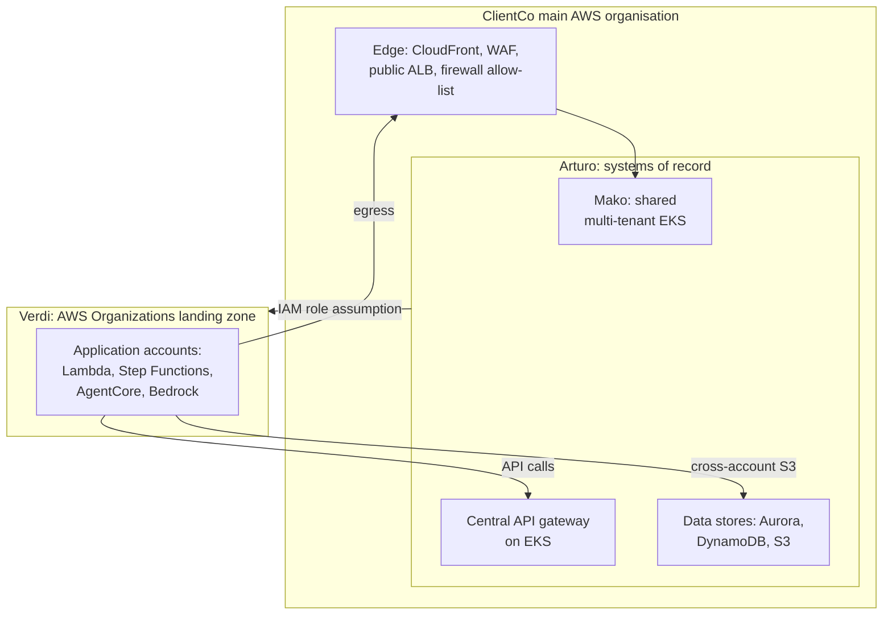
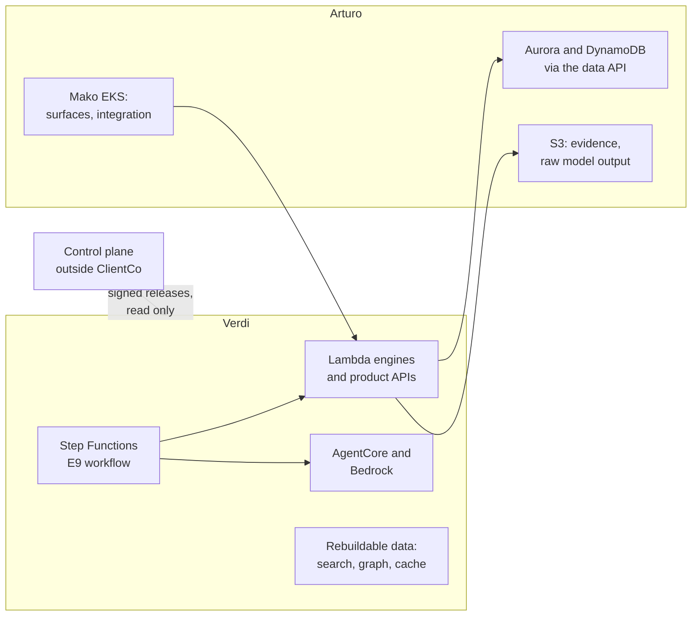

# Cloud Architecture: Living Knowledge Document

**What this is.** The single record of what the team knows about the ClientCo AWS estate and the cloud architecture of the product: the estate, the placement rules, the services, the build and release path, the decisions, the open items and the actions. Each cloud architecture meeting and each AWS or ClientCo input updates it. The log in §15 keeps what each meeting said.

**Owner.** Head of product engineering, with the NTT DATA cloud architects.
**Status.** Internal. NTT DATA only. Some content describes ClientCo internal platforms: do not share outside the project.
**Last true as of:** 9 November 2026 (meeting M01 and the AWS diagram D01).

**Sources.**
- M01: `ws2-technical/cloud/transcript_coyote_cloud_arch_0911.vtt` (9 Nov, 61 minutes)
- D01: `ws2-technical/cloud/coyote-verdi-arturo-architecture.drawio.png` (Anton's view of the product on the ClientCo estate)
- Read against: `CONTEXT.md` · `ws2-technical/ClientCo_Tech_QA_28Oct_Notes.md` · `ws2-technical/Data_Stores_Reference.md` · `ws2-technical/sdlc/s1/work-packets/S1_W2_Cloud_Architecture_and_Platform.md` · `ws1-product/context/knowledge/K3_Architecture_and_Decisions.md`

---

## How to Update This Document

1. Add a new record to §15 (M02 for a meeting, D02 for a document). Keep the earlier records.
2. Change the standing position in §2 to §10 in place. Do not add a second version of a line.
3. Add new decisions to §11. Mark a replaced decision "Replaced by D-CLD-nn".
4. Add new open items to §12. Mark a closed item "Closed", with the source that closed it.
5. Add new actions to §13, and change the status of the actions that the source reported on.
6. Change §14 if other documents need a change.
7. Change **Last true as of** and §17.

Mark a position **[H]** until the people who must agree have agreed it. Mark a statement "(Anton's view)" where it comes only from the AWS diagram.

---

## 1. The People

| Person | Organisation | Role | Source |
|---|---|---|---|
| Anton (Antonio Baxter) | AWS | One of two AWS solution architects for ClientCo, in Sydney. Supports CGM, and the retail bank on its core banking change. Works in the ClientCo office. Led the AWS proof of value. Author of D01 | M01, 00:05:15 |
| Nils (Nilojan Tharmarajah) | NTT DATA | AWS principal architect for the Australia region. Lead cloud architect for the product. Earlier at a large Australian bank for four to five years | M01, 00:03:07 |
| Ruban | NTT DATA | Cloud architect, with Nils. Background in software development, cloud infrastructure and agentic AI applications | M01, 00:03:58 |
| Vishnu | NTT DATA | AI architect. Designs the foundation of the agents. Joined in the first week of November | M01, 00:02:02 and 00:35:15 |
| Harsha Kodlaya | NTT DATA | Head of product engineering | M01 |
| Sheril | ClientCo | Core engineering director for AWS. The route for ClientCo requirements and the integration resourcing | M01, 00:28:26 |
| Sreenath and Gaurav (as heard) | ClientCo | Must permit the project to be described to the ClientCo central teams | M01, 00:10:26 |

**Note.** "Antonio" (the proof of value) and "Anton" (the ClientCo AWS estate) in earlier notes are one person: Antonio Baxter, called Anton (Harsha confirmed, 9 Nov).

---

## 2. The ClientCo AWS Estate

ClientCo has two cloud platforms on AWS: **Arturo** and **Verdi**. Both sit under the ClientCo main AWS organisation, which holds the network edge and the firewall. ClientCo also uses Google Cloud, mainly in the retail bank for data warehousing, AI and digital channels. Most core systems, in the retail bank and in CGM, run on AWS (00:05:15).

### 2.1 Arturo

- In use since 2017 to 2018. It hosts the critical CGM systems: the main risk system, and the current client lifecycle tool and its MS SQL databases. Most systems that the product integrates with are on Arturo (00:13:49).
- A security platform in the form of a cloud abstraction layer, written in Ruby on Rails. It translates **Arturo Formation**, a ClientCo IaC language, into CloudFormation. Arturo Formation covers about 20 AWS services, for example EC2, RDS, Aurora and Redshift.
- The deployment pipeline (called MAX) applies the controls to each resource.
- It has its own engines for security groups and networking. The networking engine connects the VPCs through a transit gateway.
- **VPC sets.** A set is seven VPCs, across production, non-production and UAT.
- **Mako** is the CGM multi-tenant EKS cluster on Arturo. It runs Argo CD and HashiCorp Vault for secrets. Many CGM APIs, mostly Java Spring Boot, run on Mako. The EKS API endpoint is private (00:57:29).
- **Mode 3 accounts** are AWS accounts on the Arturo network that the Arturo layer does not manage. Anton expects that the product does not need one. A Microsoft Dynamics integration may need one; Sheril to confirm (00:28:26).
- Resources are replaced, never repaired: for example a 90-day stack roll for EC2 and RDS. Backups use Commvault.
- **A new service on Arturo takes about six months** (00:45:12).

### 2.2 Verdi

- A newer landing zone on AWS Organizations. It works in the AWS-native way: CloudFormation, with CloudFormation Guard checks early in the pipeline (00:19:00).
- **Service control.** All AWS services are available except those on an explicit deny list, set by SCPs:
  - Denied: EC2, EKS, and the managed relational databases RDS and Aurora.
  - ECS Fargate: "no for now".
  - Allowed: Lambda, Step Functions, AgentCore Runtime, DynamoDB, S3, and the other managed services.
- **Step Functions with Lambda** run in a Verdi non-production account, cleared for the product in the first week of November (00:27:27).
- **No durable data.** The Verdi team can delete any account at any time, to meet ClientCo security requirements. So data at rest must reside in Arturo. Logs and data that pass through, for example Step Functions state, are exempt (00:22:11).
- **No front-end hosting and no direct internet access.** External network access goes through the ClientCo main organisation. Front ends run on Mako (00:25:03).
- **Network.** Verdi gives each new account a VPC. Verdi has no fixed network pattern beyond "in a VPC" or "a managed service". A Lambda in a VPC reaches DynamoDB through an interface endpoint (00:50:21).
- **A new service in Verdi** is available in the dev account within hours. Production needs CloudFormation Guard rules: one to three days, or one day with the Verdi engineers in the room (00:45:12).

### 2.3 Verdi account tiers

| Tier | M01 (Anton) | D01 (Anton's diagram) |
|---|---|---|
| LAB | — | No ClientCo data, 2 weeks |
| POC | All AWS services. No confidential data. Deleted after 30 days. "Where a lot of the infrastructure will land initially", against stubs | Internal data, 2 months |
| DEV | Like POC, with a higher confidentiality level. Long-lived | Confidential, long-lived |
| Non-production | Named, detail to confirm | — |
| PROD | Named | Confidential. CI/CD only. "Up to Confidential, no external hosting" |

The two sources differ on the POC tier (O-CLD-10).

### 2.4 Between Verdi and Arturo

| Path | Position | Source |
|---|---|---|
| Arturo to Verdi | IAM cross-account role assumption is allowed | 00:23:26 |
| Verdi to Arturo, IAM | Not allowed. Arturo exposes a ClientCo identifier (PRN) in place of ARNs | 00:23:26 |
| Verdi to Arturo, API | Through the central API gateway on EKS (product: probably Gloo). Tenants and consumers also use it | 00:23:26, 00:33:57 |
| Verdi to Arturo, S3 | Cross-account S3 access, open since the first week of November | 00:24:29 |
| Network | Anton: "there should be a private link". D01: "No PrivateLink anywhere" | 00:33:21; D01 (O-CLD-07) |
| Verdi to the internet | Through Arturo and the ClientCo main firewall. Added latency: Anton to check | 00:36:48 |

AWS and NTT DATA try to make the paths between the two platforms simpler. ClientCo has not agreed those changes yet (00:24:29).

---

## 3. Placement Rules for the Product

| # | Rule | Source | Status |
|---|---|---|---|
| P1 | Put everything that can run in Verdi into Verdi. Keep the Arturo footprint small: the operational databases, the S3 backups, the memory backups and the integration logic | Anton, 00:45:12 | Agreed with Harsha |
| P2 | All durable data, the databases and the files at rest, lives in Arturo. Verdi holds only data that can be rebuilt | Anton, 00:22:11 | ClientCo rule |
| P3 | Compute in Verdi is Lambda, with Step Functions for the workflow. EC2, EKS and ECS Fargate are not available in Verdi | Anton, 00:54:11 and 00:56:55 | ClientCo rule |
| P4 | The front ends run on Mako (the shared EKS cluster in Arturo). Mako also hosts the integration layer (Anton's view) | Anton, 00:25:03 and 00:58:03 | ClientCo rule for front ends; **[H]** for the integration layer |
| P5 | The product uses existing Arturo services only, as new instances. No new Arturo service is necessary | Anton, 00:46:41 | Anton's reading of the first architecture |
| P6 | Egress to the internet and to data providers goes through the ClientCo main firewall | Anton, 00:36:48; D01 | ClientCo rule |
| P7 | The control plane stays outside ClientCo, in an NTT DATA environment until the operating entity exists. ClientCo pulls the release components. Telemetry goes back to the control plane | Harsha, 00:07:37 | Confirmed (pull model, CONTEXT §8) |

---

## 4. Services: Where Each One Can Run

| Service | Verdi | Arturo | Note |
|---|---|---|---|
| Lambda | Yes | — | The compute for the engines and the product APIs |
| Step Functions | Yes, cleared | — | Non-production cleared in the first week of November |
| EventBridge, SQS | Yes | — | D01 uses both |
| Bedrock, Guardrails | Yes | — | ClientCo also uses Claude Code through Bedrock |
| AgentCore Runtime, Memory, Gateway, Policy | Yes | — | Agent memory needs a backup to Arturo (§7) |
| AgentCore harness | No | — | Pulls an image from the public ECR. The product does not need it (§7) |
| DynamoDB | Yes, but not durable | Yes | Durable tables live in Arturo (P2) |
| S3 | Yes, but not durable | Yes | Evidence and raw model output live in Arturo (D01) |
| RDS, Aurora | No | Yes | Operational database in Arturo |
| EC2, EKS | No | Yes (Mako) | — |
| ECS Fargate | No, for now | Not available (28 Oct) | — |
| Front-end hosting | No | Yes, on Mako | — |
| OpenSearch, Neptune, ElastiCache Serverless | Yes, as rebuildable data | — | D01, Anton's view |

---

## 5. The AWS View of the Target (D01)

D01 is Anton's diagram: "Project Coyote MVP on [the operating entity] + Verdi + Arturo, agentic KYC platform with NTT DATA accelerators". It is a proposal, and not yet the product position. **[H]**

**Its placement rules, as Anton wrote them:**

- The control plane is in a standalone AWS organisation outside ClientCo. It holds configuration only.
- Lambda is the only compute for the product in Verdi.
- Verdi holds no system of record. All durable data is in an Arturo data account.
- Verdi holds no user interface and no external hosting. All six surfaces run on the ClientCo multi-tenant EKS cluster.
- ClientCo data comes only through the CGM internal API gateway. Direct S3 is the agreed exception.
- Egress goes only through the ClientCo main firewall. User access goes only through Netskope.
- Identity is Microsoft Entra ID. No Cognito.

**The eleven flows:**

| # | Flow | What D01 shows |
|---|---|---|
| 1 | Staff access | CGM staff and operators sign in with Entra ID. They reach the staff surfaces on the EKS cluster through Netskope and an internal ALB |
| 2 | Counterparty portal | CloudFront, WAF and Shield, and a public ALB, into the client portal namespace on the EKS cluster (Entra ID OIDC). Each surface calls the product API (Lambda) in Verdi through the ClientCo proxy and the transit gateway |
| 3 | Case start and ingestion | Salesforce events through AppFlow, documents (S3 landing, GuardDuty malware scan, Lambda, Textract, Comprehend), and the journey API start the E9 parent workflow through EventBridge |
| 4 | Orchestration | E9 Step Functions calls the engines on Lambda, and sends bounded agent tasks to AgentCore (a Bedrock model for each task, Guardrails, MCP tools). SQS wakes and chases. People approve in the workbench |
| 5 | Systems of record | The engines reach Arturo through the transit gateway and the CGM internal API gateway. A data API writes Aurora (case, master data) and DynamoDB (ledger, events, outbox) |
| 6 | Direct S3 | The evidence vault and the raw model output go to Arturo S3 buckets (Object Lock, KMS tenant keys) with a cross-account bucket policy |
| 7 | CGM estate | The same API gateway (MCP, rate limit, authentication) reaches the entity master, CATs, FROST, SharePoint and iManage, credit, and FCR for EDD. It sends the audit export to the CGM SOC |
| 8 | Data providers | Connector workers egress through the transit gateway and the firewall domain allow-list to registries, screening, identity verification and commercial data |
| 9 | Recovery | Arturo data replicates to Melbourne (Aurora Global, DynamoDB global tables, S3 replication, replica keys). Verdi is stateless and is deployed again from IaC. RTO under 4 hours, RPO under 15 minutes |
| 10 | Release | The control plane signs release bundles. CloudFormation from Git goes through the Verdi pipeline, approved by the service owner and security. LAB, POC, DEV and PROD are separate accounts |
| 11 | Control plane | The standalone organisation holds the policy and registry store, policy packs, flags, tenant profile, signed images and releases. Verdi pulls them read-only. No customer data goes back |

**Other points in D01:**

- The engines (E1 to E11) are stateless Lambdas. Each read or write of a system of record goes to Arturo through the API gateway or direct S3.
- The control plane account holds: the policy and registry store (E2, E6, E11), policy packs and prompt bundles, AppConfig flags, the tenant profile and metering, IAM Identity Center, ECR signed images, Control Tower and SCPs, Security Hub, GuardDuty, Audit Manager, and AWS Signer.
- Rebuildable data in Verdi: OpenSearch Serverless (retrieval index), Neptune Serverless (ownership graph), ElastiCache Serverless (cache, sessions).
- Observability in Verdi: CloudWatch, X-Ray, CloudTrail, GuardDuty, Security Hub, Macie, Secrets Manager.
- The United States entities of Client 0 get the same Verdi and Arturo pair in the United States. Region pair to confirm.

**Where D01 differs from the current product position:**

| Subject | Product position before 9 Nov | D01 | Status |
|---|---|---|---|
| Engine compute | ECS Fargate (K3) | Lambda | Changes (P3, D-CLD-03) |
| Surfaces | Six surfaces on ECS Fargate, BFFs on Fargate (K6) | All six on the ClientCo EKS cluster, product API on Lambda | Changes for ClientCo (D-CLD-04) |
| Portal and staff identity | Cognito, two pools (K6, PoV pattern) | Entra ID for staff and counterparties. No Cognito | To confirm (O-CLD-08) |
| Evidence vault and raw model output | S3 in Verdi, backup bucket in Arturo (`Data_Stores_Reference.md`) | S3 in Arturo, written directly | Changes (P2) |
| Relational stores | Aurora, placement open (O2, 28 Oct) | Aurora in the Arturo data account | Answered (D-CLD-02) |
| Network to the ClientCo estate | PrivateLink, VPN, AppFlow, SFTP (K3) | Transit gateway and API gateway. "No PrivateLink anywhere". AppFlow for Salesforce | To confirm (O-CLD-07) |
| Recovery | Melbourne, to confirm. RTO 4 h, RPO 15 min proposed | Melbourne. RTO under 4 h, RPO under 15 min | Confirmed as the AWS view |

---

## 6. Build, Release and Code Promotion

**The build path.** NTT DATA builds in the NTT DATA AWS environment first, then moves the build to ClientCo (Harsha and Nils, 00:38:39). The target is the build in the ClientCo UAT environment in early January, then the sandbox and the architecture approvals (00:07:37).

**ClientCo practice (Anton):**

- **Source control.** Most ClientCo teams use GitHub Enterprise with GitHub Actions. A push to the main branch starts the build. NTT DATA has its own GitHub Enterprise organisation for the product and follows the same branch model (Harsha, 00:40:46).
- **Repository structure.** The best repository structure for an application that spans Arturo and Verdi is not settled at ClientCo. Verdi resources are in CloudFormation and Arturo resources in Arturo Formation. ClientCo has skills that help translate between them. Anton gets an answer (00:39:13).
- **Containers.** Images go first to JFrog Artifactory. A hook copies them to ECR (00:43:49). ClientCo probably has a hardened container standard (SOE). The team may need to build the images again to meet it (Nils, 00:44:08).
- **Code from an external vendor.** On the last such programme, the code went as a zip file into a data room (00:41:41). The path for the product is to confirm (O-CLD-04).
- **Developer environment.** ClientCo developers use a dev container environment (called Dexty in M01) on their laptops. It connects to the landing zones through IAM Identity Center. ClientCo has spoken about it in public, so Anton can share material (00:13:49).
- **IaC tool.** Verdi uses CloudFormation. Arturo has a little-known option for Terraform, which the ClientCo central cloud team uses. Anton asks the central cloud team on 10 November. The cloud architects prefer Terraform. The answer is the first thing they need (00:59:53).

**The AWS view of the release (D01, flow 10).** The control plane signs release bundles. CloudFormation from Git goes through the Verdi pipeline, with approval by the service owner and security.

---

## 7. Agents and AI on Verdi

- **Available:** AgentCore Runtime, Memory, Gateway and Policy, and Bedrock (00:35:15).
- **Not available:** the AgentCore harness, because it pulls an image from the public ECR. The product does not need it: the harness runs on the Strands framework, and the Runtime lets the team choose its own framework, for example LangGraph (Anton, 00:35:15).
- **LangGraph with AgentCore.** No known limit. AgentCore Evaluations now supports LangGraph (Ruban and Anton, 00:48:41 to 00:49:25).
- **Long-term agent memory.** It can sit in Verdi, with a batch copy to Arturo for persistence. Anton asked ClientCo for this pattern, and ClientCo broadly accepts it. The product can help write the pattern, because it is one of the first users (00:37:26). **[H]**
- **Agent tools that call the internet** go through Arturo and the firewall. The added latency is to confirm (00:36:48).
- **New AWS services for agents** come quickly in Verdi (§2.2).

---

## 8. Integrations

- **Anton expects integrations to be the hardest part** (00:29:16).
- Sheril's client fulfilment team builds the ClientCo APIs. The product consumes them through an integration hub. The resourcing of that work is open (O-CLD-05).
- Many ClientCo systems are changing now. A Microsoft Dynamics CRM may not be ready in time. The product probably integrates with Salesforce first (Harsha, 00:29:54).
- A Microsoft Dynamics integration may need a Mode 3 account (§2.1).
- The CGM internal API gateway is the route to ClientCo data. D01 lists the entity master, CATs, FROST, SharePoint and iManage, credit, FCR for EDD, and the CGM SOC.

---

## 9. Portability to the SaaS Target

Harsha asked how to avoid a tight link to Verdi and Arturo, so that the product can move to its own single-tenant or multi-tenant SaaS environment (00:52:37).

Anton's answer (00:53:14):

1. Most of the infrastructure runs on Verdi, in AWS-native CloudFormation. This keeps the product close to a standard AWS account.
2. The database layer in Arturo is the part that is specific to ClientCo. Design it with care.
3. An integration hub that makes the core-system integrations (for example the client lifecycle tool) a standard pattern makes the product easier to move.
4. Documentation and agent skills can deploy the Verdi infrastructure into a standard AWS account.
5. Data warehousing is outside the product.

The cloud architects design a landing zone that meets the ClientCo architecture now and the SaaS architecture later (Harsha, 00:07:37). Ruban plans to copy the Verdi VPC structure (subnets and tiers) in the NTT DATA build accounts (00:55:35).

---

## 10. Criticality, Resilience and Standards

- ClientCo classifies the criticality of each project. The tiers map broadly to the APRA CPS 230 tiers. The tier sets the RTO and the RPO, and other architecture conditions (Anton, 00:10:26).
- The tier assessment needs the ClientCo central team to know about the project. Because the project is confidential, Sreenath and Gaurav (names as heard) must permit this first.
- The ClientCo standards should come from Sheril. Anton is an outside contractor at ClientCo and cannot send ClientCo documents (00:11:23).
- D01 proposes recovery in Melbourne: RTO under 4 hours, RPO under 15 minutes.

---

## 11. Decision Register

| ID | Decision or position | Who | Date | Status |
|---|---|---|---|---|
| D-CLD-01 | The control plane stays outside ClientCo. ClientCo pulls the release components. Telemetry goes to the control plane | Harsha, in answer to Anton | 9 Nov (M01) | Confirmed |
| D-CLD-02 | Durable data (databases, files at rest) lives in Arturo. Verdi holds only rebuildable data | Anton, as a ClientCo rule | 9 Nov (M01) | ClientCo rule |
| D-CLD-03 | Engine compute in Verdi is Lambda, with Step Functions. ECS Fargate is not available | Anton; Harsha accepted | 9 Nov (M01) | ClientCo rule. Containers (for example IDP) to confirm (O-CLD-06) |
| D-CLD-04 | The front ends run on Mako, the shared EKS cluster in Arturo | Anton | 9 Nov (M01) | ClientCo rule |
| D-CLD-05 | Put as much as possible into Verdi. Keep the Arturo footprint small | Anton; Harsha agreed | 9 Nov (M01) | Agreed |
| D-CLD-06 | The product needs no new Arturo service, only new instances of existing ones | Anton | 9 Nov (M01) | **[H]** Anton's reading of the first architecture |
| D-CLD-07 | The agents use AgentCore Runtime with a framework of the team's choice (for example LangGraph). The AgentCore harness is not used | Anton, Ruban, Vishnu | 9 Nov (M01) | **[H]** Framework to confirm by the AI architect |
| D-CLD-08 | The NTT DATA build accounts copy the Verdi VPC structure | Ruban; Anton shares the structure | 9 Nov (M01) | Agreed |

---

## 12. Open Items

| ID | Open item | Owner | By when | Status |
|---|---|---|---|---|
| O-CLD-01 | The IaC tool: CloudFormation, or Terraform through the Arturo option | Anton, with the ClientCo central cloud team; then the design authority | After 10 Nov | Open |
| O-CLD-02 | The repository structure for an application that spans Verdi and Arturo, and the translation to Arturo Formation | Anton | To confirm | Open |
| O-CLD-03 | The ClientCo criticality tier for the product, which sets the RTO and the RPO. Needs Gaurav's permission to brief the central team | Harsha, with Sheril and Gaurav | To confirm | Open |
| O-CLD-04 | The code promotion path from NTT DATA to ClientCo: shared container registry, Artifactory, or a data room. Whether images must be built again to the ClientCo container standard | Nils, with Anton and Sheril | Before early January | Open |
| O-CLD-05 | The resourcing of the ClientCo APIs (Sheril's client fulfilment team) and the integration hub | Harsha, with Sheril | To confirm | Open |
| O-CLD-06 | The compute for container workloads, for example the IDP service: Lambda, or Mako | Harsha, with the W5 pod lead and Nils | Low-level design | Open |
| O-CLD-07 | The network path from Verdi to the Arturo APIs: PrivateLink (Anton in M01) or the transit gateway with no PrivateLink (D01) | Nils, with Anton | To confirm | Open |
| O-CLD-08 | Identity for the portal and staff: Entra ID for both (D01) or Cognito for counterparties (K6) | Harsha, with Sheril | To confirm | Open |
| O-CLD-09 | IP address (CIDR) allocation in Verdi, and its lead time | Anton | To confirm | Open |
| O-CLD-10 | The Verdi account tiers: the POC rules differ between M01 (30 days, no confidential data) and D01 (internal data, 2 months). The use of the non-production tier | Anton | To confirm | Open |
| O-CLD-11 | The added latency of internet calls from Verdi through Arturo | Anton | To confirm | Open |
| O-CLD-12 | Whether a Microsoft Dynamics integration needs a Mode 3 account | Sheril | To confirm | Open |
| O-CLD-13 | The pattern for the agent memory backup from Verdi to Arturo (batch) | Anton, with ClientCo | To confirm | Open |

---

## 13. Action Register

| ID | Action | Owner | When | Source | Status |
|---|---|---|---|---|---|
| A-CLD-01 | Ask the ClientCo central cloud team about Terraform on Arturo | Anton | 10 Nov | 00:59:53 | Open |
| A-CLD-02 | Share the Verdi VPC structure (subnets and tiers) for a vended account | Anton | To confirm | 00:55:49 | Open |
| A-CLD-03 | Share the public material on the ClientCo developer environment and the Arturo design principles | Anton | To confirm | 00:13:36 | Open |
| A-CLD-04 | Find the best repository structure for an application across Verdi and Arturo | Anton | "ASAP" | 00:39:13 | Open |
| A-CLD-05 | Check the CIDR allocation in Verdi and its lead time | Anton | To confirm | 00:52:28 | Open |
| A-CLD-06 | Check the added latency of internet calls from Verdi through Arturo | Anton | To confirm | 00:37:04 | Open |
| A-CLD-07 | Ask Sheril for the ClientCo security and architecture standards | Harsha | This week | 00:11:23 | Open. Same as A-SEC-16 |
| A-CLD-08 | Ask Sheril about the integration resourcing and the Microsoft Dynamics pattern | Harsha | Soon | 00:29:54 | Open |
| A-CLD-09 | Share the NTT DATA accelerators (IDP, PRESTO) with Anton, when the IP position allows | Harsha | To confirm | 00:59:13 | Open |
| A-CLD-10 | Send further questions to Anton asynchronously | Nils, Ruban | Standing | 00:56:06 | Open |
| A-CLD-11 | Hold a follow-up call with Anton this week (Anton is out on 10 Nov, 2 pm to 6 pm) | Harsha | Week of 9 Nov | 00:56:11 | Open |
| A-CLD-12 | Design the landing zone for the ClientCo pattern now and the SaaS target later | Nils, Ruban | Before early January | 00:07:37 | Open |

---

## 14. Effect on Other Documents

| Document | What changed | Effect | Done |
|---|---|---|---|
| `CONTEXT.md` §7 Hosting | Lambda in Verdi, front ends on Mako, durable data in Arturo | Change | 9 Nov |
| `ws2-technical/Data_Stores_Reference.md` | Compute, Aurora placement, evidence and raw output placement, portal identity | Change | 9 Nov |
| `ws2-technical/ClientCo_Tech_QA_28Oct_Notes.md` O1, O2 | O1 (compute) and O2 (Aurora) answered | Close | 9 Nov |
| S1 W2 work packet | Compute, data, IaC, Verdi tiers | Change | 9 Nov |
| K3 (runtime, Q&A on Fargate), K6 (surfaces on Fargate, Cognito), K4, Technical Decisions Record, DEV_01, W4B packet | Fargate and surface hosting | Change | 9 Nov |
| SAD template | Example rows name no compute service or identity product | Checked, no change | 9 Nov |

---

## 15. Meeting and Document Log

### M01 · Cloud Architecture with AWS, 9 November 2026

**What this was.** The first meeting between the NTT DATA cloud architects and Anton (AWS). It introduced the team and walked through the ClientCo AWS estate, so that the landing zone design can start.
**Source.** `ws2-technical/cloud/transcript_coyote_cloud_arch_0911.vtt` (61 minutes, recorded)
**Present.** Anton (AWS) · Nils, Ruban, Vishnu, Harsha (NTT DATA). Raymond Lie joined at the start and left for another meeting.
**Speaker map.** "@1" is Vishnu: Anton answers "great question as well, Vishnu" (00:35:15).

**The meeting in five lines.**

1. ClientCo has two AWS platforms: Arturo (systems of record, Mako EKS, a new service takes six months) and Verdi (AWS-native, fast, no durable data, no front ends).
2. The product runs as much as possible in Verdi on Lambda and Step Functions, with durable data in Arturo and the front ends on Mako.
3. AgentCore and Bedrock are available in Verdi. The team chooses the agent framework.
4. Code promotion, the repository structure, the IaC tool and integrations are the open parts. Anton expects integrations to be the hardest.
5. The control plane stays outside ClientCo with a pull model. The design must stay portable to the SaaS target.

**Talking points.**

| # | Topic | What was said | Who |
|---|---|---|---|
| 1 | Origin | The project started as a contest between AWS and Google Cloud. The proof of value showed Bedrock agents on several KYC archetypes | Anton, 00:05:15 |
| 2 | Control plane | Still a pull model with telemetry to the control plane | Anton asked; Harsha, 00:07:29 |
| 3 | Timeline | Build in the ClientCo UAT environment in early January, then the sandbox and the approvals | Harsha, 00:07:37 |
| 4 | Standards | Criticality tiers map to CPS 230 and set RTO and RPO. Sheril sends the requirements | Anton, 00:10:26 |
| 5 | Arturo | Abstraction layer, Arturo Formation, MAX pipeline, VPC sets, Mako, Mode 3, Commvault | Anton, 00:13:49 |
| 6 | Verdi | AWS Organizations, CloudFormation and Guard, deny list, account deletion, no durable data | Anton, 00:19:00 |
| 7 | Cross-platform access | IAM one way, API gateway, S3 cross-account | Anton, 00:23:26 |
| 8 | Front ends | On Mako. Internet access through the main organisation | Anton, 00:25:03 and 00:31:37 |
| 9 | Persistence | Databases, files and EBS in Arturo. Agent memory backup in batches | Ruban, Anton, 00:25:44 to 00:27:27 |
| 10 | Step Functions | Cleared in a Verdi non-production account | Anton, 00:27:27 |
| 11 | Integrations | The hardest part. Sheril's team builds the APIs. Salesforce first | Anton, Harsha, 00:29:16 |
| 12 | Agents | AgentCore available except the harness. LangGraph works | Anton, Vishnu, Ruban, 00:35:15 |
| 13 | Accounts | Build in POC or DEV in Verdi, after the NTT DATA build | Nils, Anton, 00:38:07 |
| 14 | CI/CD | GitHub Enterprise and Actions. Repository structure unclear. Data room for vendor code. Artifactory to ECR | Anton, Nils, 00:38:48 to 00:44:57 |
| 15 | Lead times | Verdi hours to days. Arturo about six months. No new Arturo service needed | Anton, 00:45:12 |
| 16 | Network | Verdi vends a VPC. No fixed topology. Interface endpoint to DynamoDB | Anton, 00:50:21 |
| 17 | Portability | Most infrastructure on Verdi in CloudFormation. Care with the Arturo data layer. Integration hub | Anton, 00:53:14 |
| 18 | Compute | ECS not available. Lambda for the engines. Mako for integration. IDP may be containers | Ruban, Harsha, Anton, 00:56:38 |
| 19 | Accelerators | Anton asked for the NTT DATA accelerators. Harsha named IDP and PRESTO | Anton, Harsha, 00:58:32 |
| 20 | IaC | Terraform may be possible on Arturo. Anton checks on 10 Nov | Ruban, Anton, 00:59:44 |

### D01 · AWS Diagram of the Product on Verdi and Arturo

**What this is.** Anton's diagram of the product MVP on the ClientCo estate, with the control plane outside ClientCo. Harsha sent it to the cloud architects before M01.
**Source.** `ws2-technical/cloud/coyote-verdi-arturo-architecture.drawio.png`
**Content.** §5 holds it in full.

---

## 16. Terms

| Term | Meaning |
|---|---|
| **Arturo** | The older ClientCo AWS platform. It hosts the systems of record and the shared EKS cluster |
| **Arturo Formation** | The ClientCo IaC language for Arturo. Arturo translates it into CloudFormation |
| **CloudFormation Guard** | A policy check for CloudFormation templates. Verdi uses it before deployment |
| **Mako** | The CGM multi-tenant EKS cluster on Arturo |
| **Mode 3 account** | An AWS account on the Arturo network that the Arturo layer does not manage |
| **PRN** | A ClientCo resource identifier that Arturo uses in place of an AWS ARN |
| **SCP** | Service control policy. Verdi uses SCPs for its deny list |
| **SOE** | Standard operating environment: a hardened base image |
| **Verdi** | The newer ClientCo AWS landing zone, on AWS Organizations |
| **VPC set** | A group of seven VPCs on Arturo, across production, non-production and UAT |

---

## 17. Change History

| Date | Source | Sections | Description |
|---|---|---|---|
| 9 Nov 2026 | M01, D01 | All | First version, from the cloud architecture meeting with AWS and the AWS diagram |
