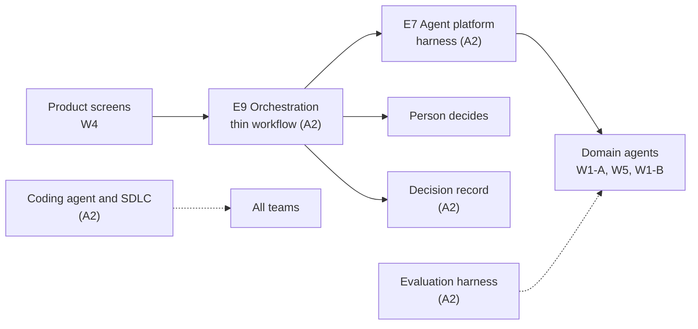
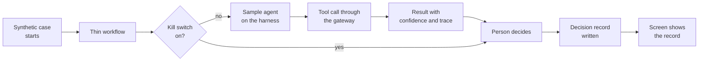

---
id: S1-WP-A2
title: Sprint 1 work packet, A2 agent platform and agentic SDLC
version: 1.0
status: issued
owner: A2 pod lead
approver: Head of product engineering
baseline: —
---

# Sprint 1 · A2 Agent Platform and Agentic SDLC

**What this is.** The Sprint 1 deliverables of the A2 team: the agent harness, the evaluation harness, the thin workflow, and the agentic way of work for all teams. **Read first.** The common guide, `S1_00_Common_Guide.md`.

### Local history

| Date | Version | Changed by | Sections | Description |
|---|---|---|---|---|
| 2 Nov 2026 | 1.0 | Claude, for the head of product engineering | All | First version. Shorter and atomic. Deliverables only. A running harness as the main deliverable. No dates in week 1. No dependency on A2 at the start |

---

## Summary

| | |
|---|---|
| **Job in Sprint 1** | Give the platform that runs agents under limits and measures them. Give the thin workflow and the decision record write for the end-to-end path. Make the agentic way of work ready for all teams |
| **Main deliverables** | 1. A running agent harness scaffold: lifecycle, trace, tool calls, kill switch 2. The evaluation harness baseline 3. The thin workflow and the decision record write 4. The configured coding agent, with templates, standards and the adopted flow 5. The agent pattern and the platform boundary, agreed with W1-A and W5 |
| **What the demo shows** | A sample agent runs on the harness inside the workflow, a person decides, one decision record is written, and the kill switch sends the step to a person |
| **Workbook rows** | #13, #14, #15, #16, #17, #18, #19, #20, #21 |

---

## 1. The Team in the Project

The product uses AI agents to read, classify and propose. A rule or a person makes each decision (common guide §1). A2 gives the platform that makes this safe and the same for each agent. A2 also gives the way of work that all teams use to write code with a coding agent.

**What A2 achieves for the product:**

- **E7 Agent platform.** Each agent runs as a bounded task. The task has a scope, a list of permitted tools, a confidence threshold and a model tier. Each result is a candidate with a confidence score and a trace reference. A kill switch stops an agent, and the work goes to a person.
- **E9 Orchestration.** A durable workflow holds the case. Agent tasks are short, and the workflow is long. The workflow can wait for days for a person or a client, with no compute cost while it waits.
- **The decision record.** Each decision writes one record, with the raw model output, so that a reviewer can replay it.
- **The agentic SDLC.** 40 and more engineers use one coding agent configuration, one set of templates and one review gate.

**Where the Sprint 1 work goes.** From Sprint 2, the harness scaffold becomes the base of E7, and the thin workflow becomes the base of E9. The agents of the other teams move onto the harness when it is ready. Build the scaffold in the repository and the AWS services where the product code will live.

---

## 2. Scope

| In Sprint 1 | Later |
|---|---|
| Harness scaffold: invoke contract, agent lifecycle, trace, tool calls through a gateway with an allow-list, kill switch | Guardrails at full depth, agent identity for each agent, agent policy from the agent catalogue |
| One sample agent on synthetic data, to prove the harness | The domain agents at product depth. The capability teams build them |
| Evaluation harness baseline: taxonomy, test-case format, expected-output structure, trace capture, fail and fallback criteria | Evaluation sets for each domain agent, drift reports, the evaluation gate on each model change |
| Thin workflow: start a case, call an agent step, wait for a person, write a decision record | Child workflows for each track, wake-and-chase, the case at full depth |
| Decision record write, append-only, with the raw model output | Replay at full depth, retention rules |
| Tool-call and context contracts | Case memory across runs, sandboxed compute, open-web retrieval |
| Coding agent, skills, hooks and developer access for each pod | Automatic task packets, the full plugin catalogue |
| Specification and code templates with traceable IDs | Templates for each type of development |
| Adopt and pilot the existing agentic SDLC flow on one repository | Roll out to all repositories |
| Coding standards and review criteria for the first repository | Standards for each type of development |
| IDP (intelligent document processing) platform boundary and orchestration contract, agreed with W5 | The IDP service at depth. W5 builds it |
| Rule-agent pattern and evaluation, agreed with W1-A | The rule agents in the product. W1-A builds them |

---

## 3. Deliverables

The harness, the thin workflow and the evaluation harness are working software. Each has the items of a finished prototype (common guide §5).

| # | Deliverable | Done when | Workbook row |
|---|---|---|---|
| 1 | **Agent harness scaffold**, running in the NTT DATA AWS account: invoke API, agent lifecycle, trace, tool calls through a gateway, kill switch | A sample agent runs end to end on synthetic data, and the demo scenarios pass | #14 |
| 2 | **Thin workflow and decision record write**: a durable workflow on AWS Step Functions Standard that calls an agent step, waits for a person, and writes one decision record | The workflow runs one synthetic case to a stored decision record | #14 |
| 3 | **Evaluation harness baseline**: taxonomy, test-case format, expected-output structure, trace capture, fail and fallback criteria, a runner in CI | The sample agent runs its evaluation set in CI and gives a report | #13 |
| 4 | **Tool-call and context contracts**: the tool registry and interface pattern, the rules to package context, the boundary for state and context retention | The contracts are at version 0.1.0, and the harness uses them | #15 |
| 5 | **Architecture diagram** of the harness, the workflow and the evaluation harness, with the AWS services and the data flow | The diagram matches the deployed resources | #14 |
| 6 | **SBOM, infrastructure as code, tests and README** for deliverables 1 to 3 | A second engineer builds the stack again from the code and the README | #13, #14 |
| 7 | **Harness onboarding note**: how a team moves its own agent call onto the harness, with the invoke contract and a client stub | W1-A and W5 review the note | #14, #15 |
| 8 | **Configured coding agent and approved tooling**, with skills, hooks and developer access for each pod. The standing context is the set of files that the coding agent reads at the start of each session: the repository instructions, the standards and the glossary | An engineer in each pod opens a session with the standing context and the hooks run | #16 |
| 9 | **Specification and code templates**: design, specification, implementation plan, tests, code review, with traceable IDs | One change in the pilot repository uses each template | #17 |
| 10 | **Adopted agentic SDLC flow**, piloted on one repository: spec, plan, tests, code, review, deploy | One change goes through each step of the flow to a deploy | #18 |
| 11 | **Coding standards and review criteria**: developer approval points, the review council rule for a pull request. A review council is several models from different families that review a change | The review gate applies the criteria in the pilot repository | #19 |
| 12 | **IDP platform boundary and orchestration contract**, agreed with W5: the service boundary, the stages of document processing, the interface to the evidence services | W5 and A2 record their review of the contract | #20 |
| 13 | **Rule-agent pattern and evaluation approach**, agreed with W1-A | W1-A uses the pattern and the evaluation format for its two rule agents | #21 |

---

## 4. Requirements

### Agent harness

| ID | Requirement | Verify |
|---|---|---|
| S1-A2-REQ-01 | When the workflow invokes an agent, the harness shall return a structured result with an outcome, a confidence score and a trace reference. | Test |
| S1-A2-REQ-02 | The harness shall send each agent tool call through the tool gateway. | Test |
| S1-A2-REQ-03 | If an agent calls a tool outside its allow-list, then the tool gateway shall refuse the call, stop the task and record the attempt. | Test |
| S1-A2-REQ-04 | If the confidence score is below THR-A2-01, then the harness shall return the outcome "escalate". | Test |
| S1-A2-REQ-05 | The harness shall record, for each model call, the prompt, the raw output, the model ID and the prompt version. | Inspection |
| S1-A2-REQ-06 | The harness shall read the model tier, the thresholds and the kill switch setting from configuration. | Inspection |

**Outcome.** The three outcomes of an agent result are "clear", "escalate" and "return". Each result is a candidate. A rule or a person decides.

### Kill switch and workflow

| ID | Requirement | Verify |
|---|---|---|
| S1-A2-REQ-07 | Where the kill switch for an agent is on, the harness shall refuse each invoke call to that agent. | Test |
| S1-A2-REQ-08 | Where the kill switch for an agent is on, the workflow shall send the step to a person. | Demonstration |
| S1-A2-REQ-09 | When a person changes the kill switch setting, the decision record store shall keep one record of the change. | Test |
| S1-A2-REQ-10 | While a case waits for a person, the workflow shall keep the case state. | Demonstration |
| S1-A2-REQ-11 | When a person decides a step, the workflow shall write one decision record with the decider, the evidence reference, the rule version and the agent trace reference. | Test |
| S1-A2-REQ-12 | The decision record store shall reject each change to a stored record. | Test |

### Evaluation

| ID | Requirement | Verify |
|---|---|---|
| S1-A2-REQ-13 | When a developer changes a prompt or a model tier, the pipeline shall run the evaluation set of the agent. | Test |
| S1-A2-REQ-14 | If an evaluation result is below THR-A2-02, then the pipeline shall block the merge. | Test |
| S1-A2-REQ-15 | The evaluation harness shall store each result with the agent version, the case ID and the trace reference. | Inspection |

### Agentic SDLC

| ID | Requirement | Verify |
|---|---|---|
| S1-A2-REQ-16 | At session start, the coding agent configuration shall load the standing context of the repository. | Demonstration |
| S1-A2-REQ-17 | While a check fails on a pull request, the repository shall block the merge. | Test |
| S1-A2-REQ-18 | The review gate shall approve a pull request only after a named developer approves it and two of three model families approve it. | Demonstration |

**Thresholds.** THR-A2-01 is the confidence threshold of the sample agent, value to confirm. THR-A2-02 is the evaluation pass mark, value to confirm. Both stay in configuration.

---

## 5. Demo Scenarios

| ID | Given | When | Then |
|---|---|---|---|
| S1-A2-AC-01 | A synthetic case and the sample agent with the kill switch off | The workflow calls the agent step | The agent gives a result with an outcome, a confidence score and a trace reference. The trace shows the model call and the tool call |
| S1-A2-AC-02 | The sample agent with a tool that is outside its allow-list | The agent calls that tool | The gateway refuses the call. The task stops. The trace shows the refused call |
| S1-A2-AC-03 | A result with a confidence score below THR-A2-01 | The harness returns the result | The outcome is "escalate", and the workflow gives the step to a person |
| S1-A2-AC-04 | The kill switch for the sample agent is on | The workflow reaches the agent step | The harness refuses the call. The step goes to a person. The decision record store shows the kill switch change |
| S1-A2-AC-05 | A case that waits for a person | The person approves the step | The workflow continues and writes one decision record with the decider, the evidence reference, the rule version and the trace reference |
| S1-A2-AC-06 | A pull request that changes the prompt of the sample agent, and an evaluation result below THR-A2-02 | The developer tries to merge | The merge stays blocked. The evaluation report shows the failed cases |
| S1-A2-AC-07 | An engineer in a pod repository | The engineer opens a coding agent session and edits a file | The standing context loads. The hooks run and show their result |
| S1-A2-AC-08 | A pull request in the pilot repository with each check passed | The review council and a named developer approve | The merge goes through, and the pipeline deploys the change to the NTT DATA AWS account |

**What to demo:**

- The sample agent on the harness: invoke, result, trace and raw output.
- A refused tool call that stops the task.
- The kill switch: on, the step goes to a person; the change is recorded.
- The thin workflow: a case waits for a person, then writes one decision record.
- The evaluation run in CI, and a blocked merge on a failed evaluation.
- A coding agent session with the standing context and the hooks.
- One change through the full flow, from spec to deploy, in the pilot repository.
- The harness onboarding note, the tool-call contract and the IDP orchestration contract.

---

## 6. Working with Other Teams

Each team builds in parallel from the start. A team that needs an agent uses its own simple agent call until the harness is ready. Then the team moves its call onto the harness with the onboarding note.

| Team or role | What to agree or share |
|---|---|
| **W1-A** | W1-A builds the rule-authoring agent and the rule-application agent in its prototype. A2 gives the agent pattern, the result structure and the evaluation format. Together, agree how the agents move onto the harness. The agents propose, and the approved rules decide (#21) |
| **W5** | W5 builds the IDP service, the service that reads documents and takes out facts. A2 and W5 agree the platform boundary, the stages of document processing and the orchestration contract together (#20). The W5 extraction agent moves onto the harness when it is ready |
| **W1-B** | Share the result structure and the decision record form. Agree how the readiness result uses the decision record |
| **W4 UI** | Agree the API that the screen uses to show a decision record and a person task |
| **W2** | Agree the AWS account, the repository organisation, branch protection and the pipeline. Share the review criteria for the pull request gate (#16, #19) |
| **W3** | Agree the tool approval for the coding agent, the access for the harness roles, and the security checks in the hooks |
| **Data architect** | Agree the form of the decision record and the context retention boundary |
| **AWS solution architect for Client 0** | Confirm which agent services are available in the Sydney region for the harness |
| **Head of product engineering** | Confirm the pilot repository and the adopted agentic SDLC flow |

---

## 7. Open Items

| Item | Owner (role) | By |
|---|---|---|
| To confirm: the result of the Sprint 0 reuse check of the Product Foundation harness, as an input to the scaffold | A2 pod lead | Week 2 |
| To confirm: which managed agent services to use for the runtime and the tool gateway (candidates: Amazon Bedrock AgentCore Runtime and AgentCore Gateway with MCP, the Model Context Protocol for tool calls), and their availability in the Sydney region. Record the choice in an architecture decision | A2 pod lead, with the AWS solution architect for Client 0 | Week 2 |
| To confirm: the language and framework of the harness service | A2 architect | Week 2 |
| To confirm: the status of the coding agent licences and the repository organisation from Sprint 0 | A2 pod lead, with W2 | Week 2 |
| To confirm: the coding agent route, Claude Code or Claude within aXet, and that both routes run the same hooks | A2 pod lead | Week 3 |
| To confirm: the values of THR-A2-01 and THR-A2-02. Pass thresholds need the agreement of ClientCo second line | Quality and AI assurance lead | End of sprint |
| To confirm: the ClientCo owner for the model risk rules for agents | Quality and AI assurance lead, to raise with ClientCo | End of sprint |
| To confirm: the pilot repository for the agentic SDLC flow | Head of product engineering | Week 2 |
| To confirm: if the rule-authoring agent takes its input from PRESTO output, and who owns that input | W1-A pod lead, with the A2 pod lead | Week 3 |
