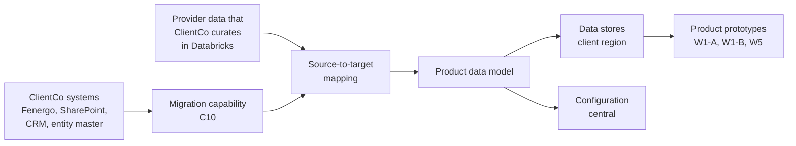
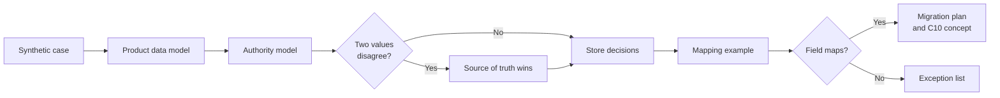

---
id: S1-WP-DA
title: Sprint 1 work packet, data architecture
version: 1.0
status: issued
owner: Data architect
approver: Head of product engineering
baseline: —
---

# Sprint 1 · DA Data Architecture

**What this is.** The Sprint 1 deliverables of the data architect: the product data model, the data store decisions and the migration decisions. **Read first.** The common guide, `S1_00_Common_Guide.md`.

### Local history

| Date | Version | Changed by | Sections | Description |
|---|---|---|---|---|
| 2 Nov 2026 | 1.0 | Claude, for the head of product engineering | All | First version. Short and atomic. Deliverables only. Architecture decisions and documents, each with a diagram. No dates in week 1. No dependency on A2 at the start |

---

## Summary

| | |
|---|---|
| **Job in Sprint 1** | Complete the data architecture of the product: the data model, the data store decisions and the migration decisions |
| **Main deliverables** | 1. The product data model, with the core entities and the data dictionary 2. The source-system inventory and the authority model 3. The data store decisions, with SharePoint or S3 for documents 4. The source-to-target mapping approach and the migration plan v0.1 on AWS Glue 5. The first concept of the migration capability (C10) |
| **What the demo shows** | One synthetic case, traced through the data model, the authority model, the stores and the migration path |
| **Workbook rows** | #1 (owner). #6 and #7 (collaboration) |

---

## 1. The Team in the Project

The data architect is one role in A1, the product and integration architecture team. The role designs the data of the product. Each team builds on this design: the prototypes keep their records in the stores that it names, and the migration loads the current ClientCo book into the same model.

**What the product holds.** The product holds the KYC data, the case state and the decision record. ClientCo owns the client master data and the policy content. Until the ClientCo master data management (MDM) system exists, the product is the transitional source of client data. Configuration is central. Customer data stays in the client region.

**Where the work goes from Sprint 2.**

- The **product data model** becomes the shared model under each part of the product. Each schema, each connector and the migration mapper use it.
- The **migration capability (C10)** takes the migration plan and the mapping approach. C10 gets its build activities in Sprint 2 and Sprint 3. The Client 0 team uses it to load the current book before go-live.

---

## 2. Scope

| In Sprint 1 | Later |
|---|---|
| The product data model at Australian depth, with a place for the terms of later jurisdictions | The content for other jurisdictions, for example the United States |
| The core entities, the data dictionary and the map of Australian customer identification procedure (CIP) terms | Changes to the model after go-live, through the release process |
| The source-system inventory for the MVP, with the Databricks provider data | The connector build. Row #6 owns the connector architecture |
| The authority model for each data class | The links to a future ClientCo MDM |
| The data store decisions, as architecture decision records | The build of each store. The teams that own the stores build them |
| The decision on SharePoint or S3 for documents | The load of existing documents |
| The source-to-target mapping approach, with one worked example for each main source | The full mapping specifications for each source |
| The migration plan v0.1, with AWS Glue as the migration tool set | The migration pipelines and the reconciliation, in C10 from Sprint 2 |
| The first concept of the migration capability (C10) | The screens of the migration workbench. Until go-live, a workbook with sign-off does this job |

---

## 3. Deliverables

Each deliverable is an architecture document or an architecture decision record (ADR), with a diagram. An ADR records one decision: the options, the choice, the reason and the owner. Use synthetic data in all examples.

| # | Deliverable | Done when | Workbook row |
|---|---|---|---|
| 1 | **Product data model** v0.1, baselined from the Sprint 0 first cut: the core entities, the attributes, the relationships and the data dictionary | The Chief Solution Architect accepts it. It has an entity-relationship diagram. Each attribute has one definition, a data class, a source precedence and a sensitivity class | #1 |
| 2 | **Source-system inventory**: each source of data for the MVP, with its provider type, its direction and its data classes. It includes the provider data that ClientCo curates in Databricks for Client 0 | The ClientCo technology lead for client fulfilment reviews it. It has a context diagram of the sources | #1 |
| 3 | **Authority model**: for each data class, the source of truth, the system that holds the bytes, and the hosting location | The Chief Solution Architect and the W3 security architect review it. It has a diagram of each data class and its owner system | #1 |
| 4 | **Data store decisions**, as ADRs: the data model type, the database layout for each engine and tenant, the store for each data class, and SharePoint or S3 for documents | The W2 cloud architect and the W3 security architect review each ADR. Each ADR has a placement diagram | #1 |
| 5 | **Source-to-target mapping approach**: how a source field maps to the product data model, who approves a mapping, and how an exception goes to a person. One worked example each for the Databricks provider data, the Fenergo extract and the CRM | Each worked example maps a synthetic record. It has a flow diagram | #1 |
| 6 | **Migration plan v0.1**: the scope, the sources, the AWS Glue job pattern, the landing store, the reconciliation, the cases in flight and the cutover | The ClientCo technology lead for client fulfilment reviews it. It has a migration flow diagram | #1 |
| 7 | **Migration capability (C10) concept v0.1**: the mapper, the load pipeline, the reconciliation and the validation exceptions, with the build activities for Sprint 2 and Sprint 3 | The head of product engineering accepts the build activities into the backlog. It has a component diagram | #1 |
| 8 | **Data architecture v0.1**: one short document that links deliverables 1 to 7 and gives the overview | It has one overview diagram. The Chief Solution Architect puts the overview into the product architecture | #1, #7 |

### The data classes

The authority model and the store decisions cover these data classes. The "Proposed" column is the starting position from the product knowledge. Confirm each line in deliverable 3.

| Data class | Proposed source of truth | Hosting |
|---|---|---|
| Client, entity and relationship | ClientCo systems of record and the entity master. The product keeps a working record, and is the transitional source until the ClientCo MDM exists | Client region |
| Case and event state | The product | Client region |
| Requirements and applicability | The product | Client region |
| Evidence and documents | The source repository. The product keeps the new documents, and a reference plus a hash for the existing documents | Client region |
| Attestations | The product, as signed records | Client region |
| Client interaction | The product, for outreach and the contact directory. To confirm | Client region |
| Lifecycle signals | ClientCo systems send the refresh triggers. The product uses them | Client region |
| Decision ledger | The product | Client region |
| Policy and configuration | ClientCo owns the policy content. The product holds the configuration | Central |
| Platform registries and access | The product | Central |
| Derived views and AI runtime | The product. The raw model output stays for replay | Client region |

### The store candidates

The data store ADRs choose from these candidates. Each is a candidate until its ADR closes.

| Data | Candidates in the product knowledge |
|---|---|
| Case, records and evidence catalogue | Aurora PostgreSQL behind a repository interface, or DynamoDB. Aurora needs RDS approval in the ClientCo AWS environment |
| Decision ledger and case events | DynamoDB, append only, with a hash chain |
| Documents | S3 with Object Lock and a customer-managed key, or SharePoint for existing documents |
| Ownership structure | Amazon Neptune, or a graph projection over the relational store |
| Search over evidence and policy | OpenSearch Serverless |
| Policy and schema artefacts | S3, versioned, central |
| Migration landing | S3, with AWS Glue jobs |

---

## 4. Requirements

### Data model

| ID | Requirement | Verify |
|---|---|---|
| S1-DA-REQ-01 | The product data model shall define each core entity, its attributes and its relationships, with one definition for each attribute in the data dictionary. | Inspection |
| S1-DA-REQ-02 | The data dictionary shall give each attribute a data class, a source precedence and a sensitivity class. | Inspection |
| S1-DA-REQ-03 | Where an Australian CIP term differs from a canonical attribute name, the terminology map shall link the term to the canonical attribute. | Inspection |

### Authority and placement

| ID | Requirement | Verify |
|---|---|---|
| S1-DA-REQ-04 | The authority model shall name the source of truth, the custody location and the hosting location for each data class. | Inspection |
| S1-DA-REQ-05 | If two sources give different values for one attribute, then the authority model shall identify the value that wins. | Demonstration |
| S1-DA-REQ-06 | The data architecture shall put each data class that holds customer data in a store in the client region. | Inspection |

### Data stores

| ID | Requirement | Verify |
|---|---|---|
| S1-DA-REQ-07 | Each data store ADR shall record the options, the decision, the reason, the decision owner and a placement diagram. | Inspection |
| S1-DA-REQ-08 | Where a data store is relational, the data architecture shall put the store behind a repository interface. | Inspection |
| S1-DA-REQ-09 | The document store ADR shall state the store for new documents and the read path for existing documents. | Inspection |

### Mapping and migration

| ID | Requirement | Verify |
|---|---|---|
| S1-DA-REQ-10 | The mapping approach shall map each source field to one canonical attribute or to the exception list. | Demonstration |
| S1-DA-REQ-11 | The migration plan shall give the scope, the AWS Glue job pattern, the landing store, the reconciliation check and the cutover for each source. | Inspection |
| S1-DA-REQ-12 | The C10 concept shall include a step where a person approves each mapping before a production load. | Inspection |

The reconciliation check uses a tolerance: **THR-DA-01, value to confirm** with the ClientCo technology lead for client fulfilment.

---

## 5. Demo Scenarios

The demo is a walk-through of the documents on synthetic data. It has no running software.

| ID | Given | When | Then |
|---|---|---|---|
| S1-DA-AC-01 | The product data model and one synthetic onboarding case | The data architect traces the case | Each record of the case shows its entity, its data class, its store and its hosting location |
| S1-DA-AC-02 | A synthetic legal name from the Databricks provider data, and a different legal name in the synthetic entity master | The authority model is applied | The value from the source of truth wins, and the record keeps the source of both values |
| S1-DA-AC-03 | A synthetic Fenergo extract record | The mapping approach is applied | Each field maps to one canonical attribute, and the mapped record shows the source of each field |
| S1-DA-AC-04 | A synthetic source field with no canonical attribute | The mapping approach is applied | The field goes to the exception list with its source and a reason, and a person resolves it |
| S1-DA-AC-05 | The data store ADRs | A reviewer selects one data class | The ADR shows the store, the options, the reason, the owner and the placement diagram |
| S1-DA-AC-06 | No ClientCo approval for the relational store service | The reviewer opens the ADR for that store | The ADR shows the alternative store and the repository interface that keeps the change to one adapter |
| S1-DA-AC-07 | A new client document and an existing document in SharePoint | The document store ADR is applied | The diagram shows where each document goes, and the evidence catalogue holds a reference and a hash for the existing document |
| S1-DA-AC-08 | A synthetic migration batch with one record count that differs from the source | The data architect shows the reconciliation design | The report format shows the count difference against THR-DA-01 and puts the batch in the validation exceptions |

**What to demo**

- The product data model and its entity-relationship diagram.
- The source-system inventory, with the Databricks provider data.
- The authority model, with one disagreement between two sources.
- The data store ADRs, with the decision on SharePoint or S3.
- One mapping example, with one exception.
- The migration plan v0.1 and the C10 concept, with the reconciliation report format.

---

## 6. Working with Other Teams

| Team or role | What to agree or share |
|---|---|
| **ClientCo technology lead for client fulfilment** | The source systems, the Fenergo extract, the scope of the migration and the cases in flight, SharePoint or S3, and the synthetic or sanitised sample data |
| **Chief Solution Architect** | The data model, the state ownership in the product architecture (row #7), and the database layout for each engine and tenant |
| **W2 cloud architect** | The store services, the AWS accounts that hold each store, the approval of each service in the ClientCo AWS environment, and the place of AWS Glue |
| **W3 security architect** | The sensitivity classes, encryption, field-level protection, residency and the access to each store |
| **Integration architect (row #6)** | The connector architecture, the path for the Databricks provider data, and the data that each connector gives |
| **ClientCo data team** | The provider data that ClientCo curates in Databricks for Client 0, and its fields |
| **W1-B** | The entity, party and ownership records in the data model |
| **W5** | The evidence catalogue fields and the document store decision |
| **A2** | The shape of the decision record and of the workflow state. A2 advises. The data architect does the design and uses its own assumptions where A2 has no answer yet |

If a decision of another team is still open, the data architect records an assumption in the ADR and continues.

---

## 7. Open Items

| Item | Owner | By |
|---|---|---|
| Name the data architect | Head of product engineering | Week 2 |
| A relational or a document model for case data: Aurora PostgreSQL or DynamoDB | Chief Solution Architect, with the data architect | Week 2 |
| One database for each engine, or one cluster for each tenant with one schema for each engine | Chief Solution Architect | Week 2 |
| Approval of RDS (Aurora) in the ClientCo AWS environment | W2 cloud architect, with the ClientCo cloud platform team | Week 3 |
| The ClientCo owner of the Databricks data curation | ClientCo technology lead for client fulfilment | Week 2 |
| What "system of record" means for each data class: authority, custody or both | ClientCo technology lead for client fulfilment | Week 3 |
| SharePoint or S3 for documents | Data architect, with the ClientCo technology lead for client fulfilment | End of sprint |
| A copy of an existing document into the product store when a decision uses it and replay needs the content | Data architect, with ClientCo second line | End of sprint |
| The graph store: Amazon Neptune or a graph projection | Data architect, with W1-B | End of sprint |
| The scope of the migration: the Australian book and the cases in flight. The proposal is a migration in the sequence of review due dates | ClientCo technology lead for client fulfilment | End of sprint |
| The value of THR-DA-01 | ClientCo technology lead for client fulfilment | End of sprint |
