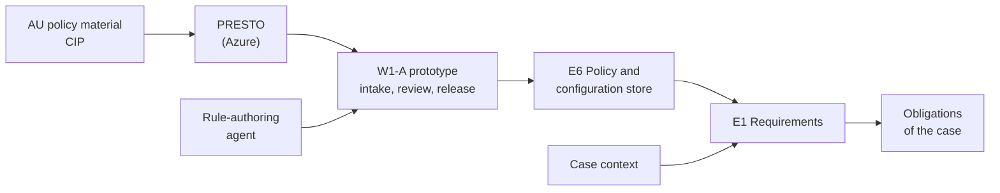
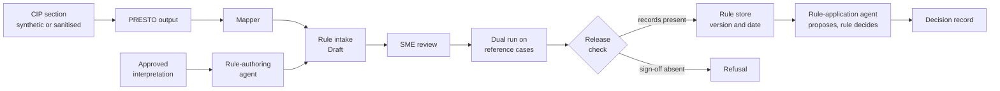

---
id: S1-WP-W1A
title: Sprint 1 work packet, W1-A policy and rules
version: 2.0
status: issued
owner: W1-A pod lead
approver: Head of product engineering
baseline: —
---

# Sprint 1 · W1-A Policy and Rules

**What this is.** The Sprint 1 deliverables of the W1-A team: a working prototype that turns policy documents into rules that a machine runs, and the documents that go with it. **Read first.** The common guide, `S1_00_Common_Guide.md`.

### Local history

| Date | Version | Changed by | Sections | Description |
|---|---|---|---|---|
| 2 Nov 2026 | 1.0 | Claude, for the head of product engineering | All | First version |
| 2 Nov 2026 | 2.0 | Claude, for the head of product engineering | All | Shorter and atomic. Deliverables only. Prototypes as the main deliverable where it applies. No dates in week 1. No dependency on A2 at the start |

---

## Summary

| | |
|---|---|
| **Job in Sprint 1** | Build a working prototype that takes AU policy material through PRESTO to rules in JSON. Subject matter experts (SMEs) review the rules. A rule then runs on a synthetic case |
| **Main deliverables** | 1. The policy-to-rules prototype, in the NTT DATA AWS account 2. The two rule agents in the prototype: rule-authoring and rule-application 3. The architecture diagram, the SBOM, the IaC, the tests and the README 4. The SME validation log and the reference cases 5. The reuse assessment for PRESTO, and the E6 and E1 specifications at version 0.1 |
| **What the demo shows** | A CIP section goes through PRESTO to a JSON rule, an SME accepts it, and the rule decides a synthetic case |
| **Workbook rows** | #22 (W1-A part), #24, #25, #28 (W1-A part), and A2 row #21 with A2 |

---

## 1. The Team in the Project

**The problem.** ClientCo writes its know-your-client policy as documents. An example is the customer identification procedure (CIP) for Australia. The CIP tells what a client gives, by entity type, product, risk and due diligence (DD) level. Today, people read the CIP and apply it by hand. The product applies the same policy in the same way to each case. It also shows which version of which rule gave each result.

**What W1-A achieves for the product.** W1-A owns the path from a policy document to an approved rule, and the place where the rules live. Each rule has a link to its policy clause, a version and an effective date. A person approves each rule before it has an effect on a case. A rule decides. An agent only proposes.

**Where the Sprint 1 work goes.** The prototype code goes into two engines from Sprint 2:

- **E6 Policy and configuration store.** It holds the rules, the thresholds and the configuration settings, each with a version and an effective date. It takes candidate rules from any drafter: a person, an agent or PRESTO. It makes no AI model call.
- **E1 Requirements.** It finds the obligations of a case. It reads the case context and evaluates the approved E6 rules against it. The same context and the same rule version give the same result each time.

**PRESTO** is an NTT DATA asset. It reads process and policy material and gives structured output, such as rule candidates. It runs on Azure. Sprint 1 tests how well PRESTO output becomes product rules.

---

## 2. Scope

| In Sprint 1 | Later |
|---|---|
| One rule family from one CIP section, on synthetic data and TEST values | The full set of AU CIP rules, written with ClientCo Financial Crime Risk (FCR), from Sprint 2 |
| PRESTO output mapped into JSON candidate rules | The mapping from JSON to the chosen rule language (Drools, OPA or Cedar) |
| A thin rule intake, an SME review record, a dual run and a release check | The approval matrix by change class, the signed release, and the product approval screen from W4 |
| A thin versioned rule store and a rule evaluator, built towards E6 | The full E6 rule model, store and resolver |
| A case context schema and one rule run on a synthetic case, built towards E1 | The full E1 attribute model, the obligation derivation and the change delta on refresh |
| The rule-authoring and rule-application agents, with a simple agent call | The move of both agents onto the A2 agent harness, and the evaluation gate |
| A decision record written to a stub with the A2 record shape | The real decision ledger |

---

## 3. Deliverables

**Build the prototype in the place where its code will live.** Put the code in the E6, E1 and agent repositories. Then the code moves into the engines from Sprint 2 with few changes. Keep each ClientCo policy value out of the code. Use TEST values with the label TEST.

| # | Deliverable | Done when | Workbook row |
|---|---|---|---|
| 1 | **Policy-to-rules prototype.** PRESTO output for one CIP section goes through a mapper into the rule intake as JSON candidate rules. An SME records a review result for each candidate. A dual run tests the candidates on the reference cases (synthetic cases, each with an expected outcome). A release check gives a version and an effective date | Scenarios AC-01, AC-02, AC-04 and AC-05 pass in the NTT DATA AWS account | #24, #25 |
| 2 | **Rule-authoring agent, in the prototype.** It reads an approved interpretation of a clause and proposes one candidate rule with a clause reference, a confidence score and evidence | Scenario AC-03 passes. The proposal enters the intake as "Draft" | #21 (with A2) |
| 3 | **Rule-application path, in the prototype.** The rule-application agent proposes the case context of a synthetic case. The rule evaluator decides. One decision record shows the rule ID and the rule version | Scenarios AC-06 and AC-07 pass | #21 (with A2) |
| 4 | **Versioned rule store, in the prototype.** It returns the rule versions in force on a date. A released version stays as it is | Scenario AC-08 passes | #25, #28 |
| 5 | **Architecture diagram.** The parts, the AWS services, PRESTO on Azure, and the data flow into the NTT DATA AWS account | The diagram is in the repository and the Chief Solution Architect has it for the product architecture | #28 |
| 6 | **SBOM.** Each library, AWS service, model and PRESTO version that the prototype uses, with its version and licence | The SBOM is in the repository and matches the deployed build | #28 |
| 7 | **Infrastructure as code.** The AWS resources of the prototype as code | The pipeline builds the prototype again from the code | #28 |
| 8 | **Tests and reference cases.** Automated tests for each scenario. Synthetic reference cases for the rule family, each with an expected outcome | The tests pass in the pipeline. Each expected outcome has a check against its policy source | #25, #28 |
| 9 | **README.** How to run the prototype, what it proves, and what is not done yet | A person outside the team runs the prototype from the README | #28 |
| 10 | **SME validation log.** Each candidate rule as accepted, rejected or unresolved, with its policy source | The log covers each candidate of the rule family | #25 |
| 11 | **Reuse assessment.** One IP register entry for PRESTO and for each policy asset that the team uses: fit, gaps, licence and IP terms, and a recommendation | The entries are in the IP register before PRESTO output enters the code | #22 |
| 12 | **Specifications at version 0.1.** The E6 and E1 engine specifications, and the specification of each rule agent | The documents are in the repository with their approvers | #28 |
| 13 | **Package for A1.** The specifications, the first rules with their approval status, the reference cases, the prototype result and the known limits | A1, the team that integrates the product baseline, accepts the package | #28 |

**AWS services.** The sources name these services. Choose the rest in an architecture decision with W2.

| Use | Service | Status |
|---|---|---|
| Model calls of the two agents | Amazon Bedrock | Named in the sources |
| PRESTO output files and the raw output of each agent call | Amazon S3 | Named in the sources |
| Secrets | AWS Secrets Manager | Common guide §9 |
| The rule store | Amazon Aurora or another store | To confirm. Keep the rules behind a repository interface |
| The API and the compute of the prototype | Team choice | To confirm in an architecture decision |

---

## 4. Requirements

**Thresholds.** `THR-W1A-01` is the pass level for the rule proposals of the rule-authoring agent, value to confirm. `THR-W1A-02` is the confidence level for an attribute of the case context, value to confirm. Sprint 1 uses TEST values.

### PRESTO path and rule intake

| ID | Requirement | Verify |
|---|---|---|
| S1-W1A-REQ-01 | When the PRESTO mapper reads a PRESTO output file, the PRESTO mapper shall give one JSON candidate rule or one refusal with a reason for each item in the file. | Test |
| S1-W1A-REQ-02 | When a drafter posts a candidate rule with a clause reference, the rule intake shall store the candidate in the state "Draft" with its drafter and its clause link. | Test |
| S1-W1A-REQ-03 | If a candidate rule has no clause reference, then the rule intake shall refuse the candidate with a stable error code. | Test |
| S1-W1A-REQ-04 | If a candidate rule uses an attribute outside the case context schema, then the rule intake shall refuse the candidate and name the attribute. | Test |

### Rule-authoring agent

| ID | Requirement | Verify |
|---|---|---|
| S1-W1A-REQ-05 | When the rule-authoring agent receives an approved interpretation, the rule-authoring agent shall propose one candidate rule with a clause reference, a confidence score and evidence references. | Test |
| S1-W1A-REQ-06 | When the rule-authoring agent returns a proposal, the workflow stub shall post the proposal to the rule intake in the state "Draft". | Test |
| S1-W1A-REQ-07 | The rule proposals of the rule-authoring agent shall reach `THR-W1A-01` on the evaluation set of approved interpretations. | Evaluation. Sprint 1 records the result. The gate starts in Sprint 2 |

### SME review and release

| ID | Requirement | Verify |
|---|---|---|
| S1-W1A-REQ-08 | When an SME records a review result for a candidate rule, the review service shall store the result, the SME role and the policy source. | Test |
| S1-W1A-REQ-09 | When a person starts a dual run for a candidate rule pack, the dual run service shall report pass or difference for each reference case, grouped by rule. | Test |
| S1-W1A-REQ-10 | If a candidate rule from PRESTO has no ClientCo compliance sign-off record, then the release check shall refuse the release with a stable error code. | Test |
| S1-W1A-REQ-11 | When a candidate rule has a passing dual run record and an accepted review record, the release check shall give the rule a version and an effective date. | Test |

### Rule store and rule application

| ID | Requirement | Verify |
|---|---|---|
| S1-W1A-REQ-12 | When a caller reads the rules with an as-of date, the rule store shall return the rule versions in force on that date. | Test |
| S1-W1A-REQ-13 | If a caller tries to change a released rule version, then the rule store shall refuse the change. | Test |
| S1-W1A-REQ-14 | When the workflow step calls the rule-application agent, the rule-application agent shall return the case context with a confidence score and evidence references for each attribute. | Test |
| S1-W1A-REQ-15 | If the confidence score of an attribute is below `THR-W1A-02`, then the workflow step shall send the case to a human task stub. | Test |
| S1-W1A-REQ-16 | The rule evaluator shall give the same result for the same case context and the same rule version, with no model call. | Test |
| S1-W1A-REQ-17 | When the rule evaluator returns a result, the workflow step shall write one decision record with the case ID, the rule ID and the rule version. | Test |
| S1-W1A-REQ-18 | Where the kill switch is on, the workflow step shall send the task to a human task stub. | Test |

**The AI pattern.** REQ-05, REQ-06 and REQ-11 are a linked set: the agent proposes, a person reviews, and the release check releases. REQ-14 to REQ-17 are a second set: the agent proposes the case context, and the rule decides.

---

## 5. Demo Scenarios

| ID | Given | When | Then |
|---|---|---|---|
| S1-W1A-AC-01 | A PRESTO output file for one CIP section | The mapper runs | Each item shows as a JSON candidate in the state "Draft" with its clause link, or as a refusal with a reason. The counts agree |
| S1-W1A-AC-02 | One candidate with no clause reference, and one candidate with an attribute outside the case context schema | A drafter posts each candidate | Each post gets a refusal with a stable error code. The second refusal names the attribute. The store holds no new row |
| S1-W1A-AC-03 | An approved interpretation with its clause reference | The workflow stub calls the rule-authoring agent | The proposal shows a clause reference, a confidence score and evidence. The intake shows it as "Draft" with the drafter "agent". The raw output reference is in the record |
| S1-W1A-AC-04 | A candidate rule with an "accepted" SME review | A person starts the dual run, then the release | The dual run report shows pass for each reference case. The rule gets a version and an effective date |
| S1-W1A-AC-05 | A candidate from PRESTO with a passing dual run and no compliance sign-off record | A person tries the release | The release check shows a refusal with a stable error code. The candidate stays "Draft" |
| S1-W1A-AC-06 | A released rule and a synthetic case with an expected outcome | The workflow step runs | The agent proposes the case context. The decision equals the expected outcome. One decision record shows the rule ID and the rule version. An outcome in the agent text has no effect |
| S1-W1A-AC-07 | The agent gives an attribute with confidence below `THR-W1A-02`, or the kill switch is on | The workflow step runs | The human task stub shows the case. The rule writes no decision record |
| S1-W1A-AC-08 | Rule version 1 in force from test date D1, and version 2 from test date D2 | A caller reads with a date between D1 and D2, then with a date after D2. Then the caller tries to change version 1 | The first read shows version 1. The second read shows version 2. The change gets a refusal |

**What to demo**

- A CIP section in PRESTO, and its output as JSON candidate rules in the intake.
- A candidate with no clause link, refused with its error code.
- The rule-authoring agent: one proposal from an approved interpretation, with its confidence score and evidence.
- The SME review: accept, reject and unresolved, each with the policy source, in the validation log.
- The dual run report, a refused release, and a released rule with its version and effective date.
- Two reads of the same rule on two dates, with two versions.
- One synthetic case: the agent proposes the case context, the rule decides, and the decision record shows the rule version.
- The low-confidence path and the kill switch, both to a human task.
- The architecture diagram, the SBOM and the README.

---

## 6. Working with Other Teams

| Team or role | What to agree or share |
|---|---|
| **A2** | Build the two rule agents together (row #21). W1-A builds them, and A2 advises on the platform pattern. The agents use a simple agent call through Amazon Bedrock behind an invoke interface. When the A2 harness is ready, move the agents onto it. Share the decision record shape and the human task shape early |
| **PRESTO owner** | Agree access to PRESTO, the PRESTO output format, and a sample output file. Until a file arrives, use a PRESTO-format sample file with the label TEST |
| **NTT DATA partner team for policy on PRESTO** | Agree who owns the PRESTO run (row #24). Share the rule schema and the intake API, so each drafter uses the same entry |
| **W1-B** | Agree the case context schema and the rule read API. W1-B uses both for risk and readiness |
| **W5** | Share the rule read API. W5 reads rule values for document checks |
| **W2** | Agree the repositories for E6, E1 and the agents, the account access and the pipeline. Agree the compute and API services in an architecture decision. Give the architecture diagram for the product architecture |
| **W3** | Agree how PRESTO output moves from Azure into the NTT DATA AWS account. Agree the access baseline for the prototype |
| **Data architect** | Agree the data model of the rule store and the case context, so it matches the product data architecture |
| **W4 UX** | Share the SME review steps, as input to the design of the product approval screen |
| **Chief Solution Architect** | Review the E6 and E1 specifications. Agree the rule language and the rule store service |
| **NTT DATA AI Product Unit** | Share the result of its rule run on AWS with one test agent. Keep the evaluator behind one interface, so the result fits in |
| **ClientCo FCR, through the head of product engineering** | Agree the rule family, the sanitised CIP section, an SME reviewer and a compliance signatory |
| **A1** | Agree the content of the package (row #28) and the IP register entries (row #22) |

---

## 7. Open Items

| Item | Owner (role) | By |
|---|---|---|
| The owner of the PRESTO run (row #24): W1-A, or the NTT DATA partner team for policy on PRESTO | Head of product engineering, with the partner team | Week 2 |
| Access to PRESTO and the PRESTO output format | PRESTO owner, through the head of product engineering | Week 2 |
| The sanitised AU CIP section, and ClientCo clearance to process it in PRESTO on Azure | Head of product engineering, with ClientCo FCR | Week 2 |
| The Sprint 1 rule family and CIP section. The proposal is the private-company entity-type rules for simplified DD | W1-A pod lead, with ClientCo FCR | Week 2 |
| The ClientCo FCR reviewer for the SME review, and the compliance signatory. If they are not available, the log shows the team review and the approval shows "pending" | Head of product engineering, with ClientCo | Week 3 |
| How the rule-application agent starts the rule: the workflow step calls the evaluator, or the agent calls it as a tool | W1-A AI architect, with A2 | Week 2 |
| The compute and API services of the prototype | W1-A pod lead, with W2 | Week 2 |
| The rule store service: Amazon Aurora or another store | Chief Solution Architect | End of sprint |
| The rule language: Drools, OPA or Cedar. Sprint 1 uses JSON | Chief Solution Architect, with the partner team | End of sprint |
| The values of `THR-W1A-01` and `THR-W1A-02` | A2 quality and AI assurance lead. ClientCo second line agrees the pass levels later | End of sprint |
| The agent call of the walking skeleton: the rule-application agent, the W5 extraction agent, or both | Head of product engineering, with A2 | Week 3 |
| The ClientCo owner role of the policy rules. The proposal is the FCR policy function | Head of product engineering, with ClientCo | End of sprint |
