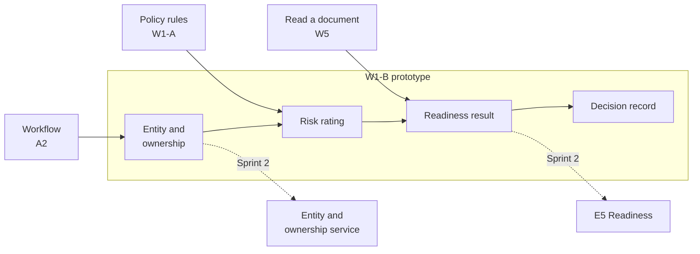
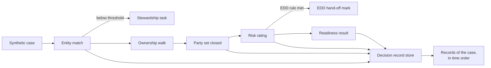

---
id: S1-WP-W1B
title: Sprint 1 work packet, W1-B risk, entity and ownership
version: 2.0
status: issued
owner: W1-B pod lead
approver: Head of product engineering
baseline: —
---

# Sprint 1 · W1-B Risk, Entity and Ownership

**What this is.** The Sprint 1 deliverables of the W1-B team, and the demo at the end of the sprint. **Read first.** The common guide, `S1_00_Common_Guide.md`.

### Local history

| Date | Version | Changed by | Sections | Description |
|---|---|---|---|---|
| 2 Nov 2026 | 1.0 | Claude, for the head of product engineering | All | First version |
| 2 Nov 2026 | 2.0 | Claude, for the head of product engineering | All | Shorter and atomic. Deliverables only. Prototypes as the main deliverable where it applies. No dates in week 1. No dependency on A2 at the start |

---

## Summary

| | |
|---|---|
| **Job in Sprint 1** | Build a working prototype that finds an entity and its owners, rates the risk, and gives a readiness result with a decision record |
| **Main deliverables** | 1. The prototype, running in the NTT DATA AWS account, with its architecture diagram and SBOM 2. The FinSight and BankGuard reuse assessment 3. The AU risk and due diligence rule set v0.1 4. The synthetic scenarios and case data 5. The entity and ownership service definition v0.1 |
| **What the demo shows** | A synthetic client goes from entity match to a readiness result, and each decision writes one record |
| **Workbook rows** | #22 (W1-B part), #23, #26, #27, #28 (W1-B part) |

---

## 1. The Team in the Project

Before a bank trades with a client, it must answer three questions:

1. Who is the client, and who owns and controls it?
2. How risky is the client, and which due diligence does it get?
3. Is the case complete, so that the client is ready to trade?

W1-B builds the parts of the product that answer these questions. Rules give each answer. A person resolves each case that the rules do not resolve. Each decision writes a record.

**Where the Sprint 1 code goes.** From Sprint 2, the prototype code moves into two parts of the product:

- **E5 Readiness.** The engine that tells if a case is complete. It uses rules only, with no model call.
- **The entity and ownership service.** The service that matches a client against the client record, walks the ownership, and closes the party set.

The rating code and the rule set feed the risk and due diligence work in Sprint 2. Build each part of the prototype in the place where its code will live.

**Terms used in this packet.**

| Term | Meaning |
|---|---|
| **ABN, ACN, LEI** | Australian Business Number, Australian Company Number, Legal Entity Identifier |
| **Working record** | The current record of a client. In Sprint 1, a synthetic copy |
| **Stewardship task** | A task for a data steward, a person who resolves a match that the service does not resolve |
| **Ownership walk** | The step that follows each owner of an entity, layer by layer, to a configured depth |
| **Party set** | The closed list of entities and persons that the case is about. Screening uses this list |
| **UBO** | Ultimate beneficial owner: a natural person who owns or controls the client |
| **Due diligence (DD)** | The checks on a client. Simplified DD is for low risk. Enhanced DD (EDD) is for high risk |
| **EDD hand-off** | The step that sends a high-risk case to the ClientCo EDD team |
| **Idempotency key** | A key on a request. The same key sent again gives no second record |
| **IP register** | The A1 list of each asset, with its owner, licence and assessment result |
| **Reference case** | A test case with a known correct result |

---

## 2. Scope

| In Sprint 1 | Later |
|---|---|
| Entity match on synthetic data: identifier match on ACN, ABN or LEI, and name normalisation, on the FinSight or BankGuard component where it fits | Search against the ClientCo working record and the provider data that ClientCo curates (Sprint 2) |
| A thin ownership walk over a relational table of synthetic ownership data | Complex ownership structures, and an ownership change on refresh (Sprint 4) |
| Party set closure, and reopen for a late party | Screening of the party set through the ClientCo screening capability (Sprint 2) |
| Risk rating from the rule set v0.1, with test values for weights and bands | ClientCo values, and the comparison with the Fenergo reference ratings (Sprint 2) |
| One readiness result for one case, from the outputs of the prototype | Readiness for each module, called by the product workflow (Sprint 2 and Sprint 3) |
| A simple decision record store of W1-B, append only | The shared decision ledger. The record moves there when it exists |
| Synthetic scenarios, and the plan for the sanitised AU cases | The December case set of about 30 sanitised AU cases |
| Reuse assessment of FinSight and BankGuard | Reuse assessment of other NTT DATA assets (W1-A) |

---

## 3. Deliverables

| # | Deliverable | Done when | Workbook row |
|---|---|---|---|
| 1 | **The W1-B prototype.** Entity match, ownership walk and party set, risk rating, readiness result and decision record store, on synthetic data | It runs in the NTT DATA AWS account, and each demo scenario in §5 passes | #23, #26, #28 |
| 2 | **Architecture diagram** of the prototype: the parts, the AWS services and the data flow | The W2 cloud architect has it for the product architecture | #23, #28 |
| 3 | **SBOM** of the prototype | It lists each library, each AWS service and each FinSight or BankGuard component, with its version and licence | #22, #28 |
| 4 | **Infrastructure as code, tests and README** (common guide §5) | The pipeline builds the prototype from code. Each scenario has an automated test. The README says what is not done yet | #28 |
| 5 | **API contracts** at v0.1.0: entity match, party set, rating, readiness | Each contract is in the repository before its code | #28 |
| 6 | **FinSight and BankGuard reuse assessment**: fit, gaps, licence and IP terms, recommendation | A1 has one IP register entry for each asset | #22 |
| 7 | **Entity and ownership service definition v0.1**: current state on FinSight and BankGuard, target boundary, a proposal for the accuracy targets and the stop condition | The product lead has it for a decision with ClientCo KYC operations | #23 |
| 8 | **AU risk and due diligence rule set v0.1**: risk factors, DD treatment, screening population and EDD hand-off rules, each mapped to a source input | The product lead has it for the ClientCo Financial Crime Risk (FCR) review | #26 |
| 9 | **Scenarios and synthetic case data**: normal, evidence gap, exception and hand-off. A plan for the sanitised AU cases of the December case set | The files are in the repository, each with its expected results | #27 |
| 10 | **The W1-B Sprint 1 package for A1**: the specifications, the first rules, the reference cases, the prototype result and the known limitations | A1 has the package README at the end of the sprint | #28 |

**Prototype shape.** The team chooses the AWS services in an architecture decision record (ADR), with the W2 cloud architect. The candidates come from the product architecture.

| Part | What it does | AWS candidates, to confirm in the ADR |
|---|---|---|
| Entity service | Matches an entity against the synthetic working record | AWS Lambda. The FinSight or BankGuard component behind a thin W1-B service |
| Party set service | Walks the ownership and closes the party set | AWS Lambda, over a relational table |
| Rating service | Applies the rule set from configuration | AWS Lambda. Rules and test values in configuration |
| Readiness evaluator | Gives the readiness result of a case | AWS Lambda. Rules only, no model call |
| Decision record store | Keeps one record for each decision, append only | Amazon DynamoDB. The product ledger proposal is DynamoDB with hash-chained records |
| API | Exposes the four contracts | Amazon API Gateway, private endpoint, IAM authorisation |
| A simple driver | Calls the parts in order for one case | A test client, or AWS Step Functions |

---

## 4. Requirements

The values in the prototype are test values. They are not ClientCo policy values. `THR-W1B-01` is the match threshold, value to confirm. `THR-W1B-02` is the ownership depth, value to confirm.

### Entity match

| ID | Requirement | Verify |
|---|---|---|
| S1-W1B-REQ-01 | When the entity service resolves an entity with a match score at or above `THR-W1B-01`, the entity service shall link the entity to the working record. | Test |
| S1-W1B-REQ-02 | If the match score is below `THR-W1B-01`, then the entity service shall create a stewardship task and keep the two records separate. | Test |
| S1-W1B-REQ-03 | The entity service shall return the same result and the same match score for the same input. | Test |

### Ownership and party set

| ID | Requirement | Verify |
|---|---|---|
| S1-W1B-REQ-04 | When the ownership walk ends on each branch, the party set service shall close the party set with a basis for each end of the walk. | Test |
| S1-W1B-REQ-05 | When a party arrives after the party set closes, the party set service shall reopen the party set and add the party. | Test |
| S1-W1B-REQ-06 | If the ownership walk reaches a branch with no source for the owner, then the party set service shall mark the branch "Unresolved, to a person" and keep the party set open. | Test |

### Risk rating

| ID | Requirement | Verify |
|---|---|---|
| S1-W1B-REQ-07 | When the rating service rates a case, the rating service shall return the rating, the DD treatment, an explanation for each factor and the rule version. | Test |
| S1-W1B-REQ-08 | The rating service shall return the same rating and the same explanation for the same input and the same rule version. | Test |
| S1-W1B-REQ-09 | If a mandatory factor has no value, then the rating service shall return "Not rated" with the name of the missing factor. | Test |
| S1-W1B-REQ-10 | When a case meets an EDD hand-off rule, the rating service shall mark the case for the EDD hand-off. | Test |

### Readiness and decision record

| ID | Requirement | Verify |
|---|---|---|
| S1-W1B-REQ-11 | When the readiness evaluator receives a case, the readiness evaluator shall return a readiness state and the list of open needs. | Test |
| S1-W1B-REQ-12 | The readiness evaluator shall mark an evidence need "Satisfied" only from an item that meets the acceptance conditions of the need. | Test |
| S1-W1B-REQ-13 | When a match, a party set closure, a rating or a readiness decision completes, the decision record store shall append one record with the actor type, actor, action, rule version, evidence references, tenant ID, case ID and correlation ID. | Test |
| S1-W1B-REQ-14 | If a write arrives again with the same idempotency key, then the decision record store shall keep the first record as the only record. | Test |

### Documents

| ID | Requirement | Verify |
|---|---|---|
| S1-W1B-REQ-15 | The reuse assessment shall give the fit, the gaps, the licence and IP terms, and a recommendation for FinSight and for BankGuard. | Inspection |
| S1-W1B-REQ-16 | The entity and ownership service definition shall state the target boundary and a proposal for the accuracy targets and the stop condition. | Inspection |
| S1-W1B-REQ-17 | The rule set v0.1 shall name a source input, or "To confirm", for each risk factor, DD treatment, screening population rule and EDD hand-off rule. | Inspection |
| S1-W1B-REQ-18 | The scenario set shall contain at least one synthetic case of each type: normal, evidence gap, exception and hand-off. | Inspection |

---

## 5. Demo Scenarios

| ID | Given | When | Then |
|---|---|---|---|
| S1-W1B-AC-01 | A synthetic entity with an exact ACN and a name variant | The entity service resolves the entity two times | One link to the working record shows. Both runs show the same score, at or above the test value of `THR-W1B-01` |
| S1-W1B-AC-02 | A synthetic entity with a name match and no identifier | The entity service resolves the entity | The score is below the threshold. A stewardship task shows. The two records stay separate |
| S1-W1B-AC-03 | A synthetic trust with two layers of ownership | The ownership walk runs to the test value of `THR-W1B-02` | The party set shows each natural person, with a basis for each end of the walk. The status is "Closed" |
| S1-W1B-AC-04 | A closed party set | A synthetic late party arrives | The party set shows "Open" again, and the late party is in the set |
| S1-W1B-AC-05 | A branch with no source for the owner | The ownership walk reaches the branch | The branch shows "Unresolved, to a person". The party set stays "Open" |
| S1-W1B-AC-06 | The synthetic cases and the rule set v0.1 with test values | The rating service rates each case, then rates each case again | Each rating and DD treatment equals the expected result in the case file, with an explanation for each factor and the rule version. The hand-off case shows the EDD hand-off mark. The second run shows the same results |
| S1-W1B-AC-07 | A case with no value for a mandatory factor | The rating service rates the case | The result shows "Not rated" and the name of the missing factor |
| S1-W1B-AC-08 | The evidence gap case, with one evidence need that has no item | The driver runs the case from entity match to readiness, then sends one record write again with the same key | The readiness result lists the open need. The records of the case show one record for each decision, in time order |

**What to demo.**

- The prototype in the NTT DATA AWS account, with the architecture diagram and the SBOM.
- Entity match: a link above the threshold, and a stewardship task below it.
- The ownership walk on the two-layer trust, a late party, and an unresolved branch.
- The rating of the synthetic cases, with the explanation, the rule version and the EDD hand-off mark.
- One case from entity match to the readiness result, and its decision records.
- The automated tests in the pipeline, with the result of each scenario.
- The FinSight and BankGuard reuse result, the rule set v0.1 and the service definition v0.1.

---

## 6. Working with Other Teams

| Team or role | What to agree or share |
|---|---|
| **A2** | Agree the readiness call that the product workflow makes, and the field list of the decision record. A2 advises on the platform pattern. W1-B uses its own store and its own driver, and moves to the shared ledger and the workflow when they are ready |
| **W1-A** | Agree the rule format. Agree who writes the risk rules into the product rule store: W1-B writes the content, W1-A holds the store |
| **W5** | Agree the shape of an evidence item and its acceptance result, for the evidence needs. Agree the boundary of entity search and ownership work between the teams |
| **W2** | Share the architecture diagram and the ADR. Use the account, the pipeline and the IaC patterns of W2 |
| **W3** | Agree the security checks on the prototype. Agree where the Fenergo reference ratings can be kept, because they hold customer data |
| **Data architect** | Agree the entity and party model, and the shape of the working record |
| **W4 UI** | Share the shape of the readiness result and the stewardship task, for later screens |
| **A1** | Give the IP register entries and the Sprint 1 package. Share the prototype for the walking skeleton |
| **NTT DATA asset owners** | Get access to FinSight and BankGuard, a build that deploys, and the licence terms |
| **Product lead** | Share the rule set with ClientCo FCR, and the accuracy targets proposal with ClientCo KYC operations |

If a part from another team is missing, the team uses a stub (common guide §3).

---

## 7. Open Items

| Item | Owner (role) | By |
|---|---|---|
| FinSight and BankGuard: a build that deploys, access in the NTT DATA AWS account, licence terms. If they are not available, the entity service uses the identifier match and name normalisation only, and the IP register shows "asset not assessed" | W1-B pod lead, with the NTT DATA asset owners | Week 2 |
| The AWS services of the prototype, in the ADR | W1-B pod lead, with the W2 cloud architect | Week 2 |
| The ClientCo AU risk methodology. Until it arrives, the weights and bands stay "To confirm" | Product lead, with ClientCo FCR | Week 2 |
| The Fenergo reference ratings, and where they can be kept. If they arrive late, the comparison moves to Sprint 2 | W1-B pod lead, with A1 and the W3 security architect | Week 3 |
| Who writes the risk rules into the product rule store | Head of product engineering, with the W1-A and W1-B pod leads | Week 2 |
| The boundary of entity search, ownership walk and ownership graph work between W1-B, W5 and A2 | W1-B pod lead, with the W5 and A2 pod leads | Week 3 |
| The set of readiness states. The proposal is: ready, blocked, conditional, not started | Head of product engineering | Week 3 |
| The accuracy targets, the stop condition, and the ClientCo values of `THR-W1B-01` and `THR-W1B-02`. They are needed before the December case set | Product lead, with ClientCo KYC operations | End of sprint |
| If any W1-B rule reaches "approved" in Sprint 1. The approval needs ClientCo FCR | Product lead | Week 3 |
| Sample cases in the NTT DATA AWS account, and the plan to about 30 sanitised AU cases for the December case set | A1, with ClientCo | End of sprint |
