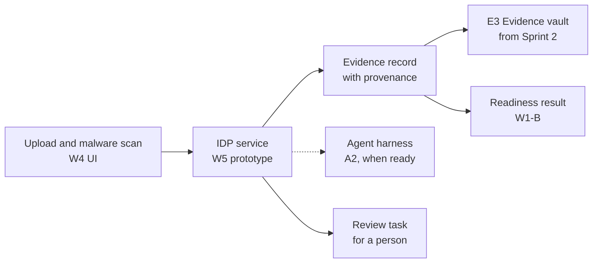
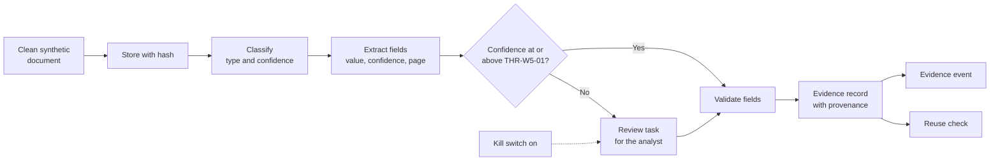
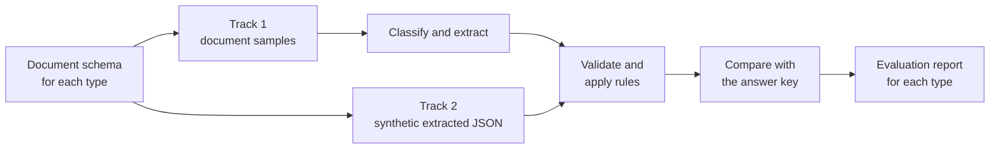

---
id: S1-WP-W5
title: Sprint 1 work packet, W5 documents and evidence
version: 2.2
status: issued
owner: W5 pod lead
approver: Head of product engineering
baseline: —
---

# Sprint 1 · W5 Documents and Evidence

**What this is.** The Sprint 1 deliverables of the W5 team: a working prototype of the intelligent document processing (IDP) service, built on AWS, and the short documents that go with it. **Read first.** The common guide, `S1_00_Common_Guide.md`.

### Local history

| Date | Version | Changed by | Sections | Description |
|---|---|---|---|---|
| 2 Nov 2026 | 1.0 | Claude, for the head of product engineering | All | First version |
| 2 Nov 2026 | 2.0 | Claude, for the head of product engineering | All | Shorter and atomic. Deliverables only. Prototypes as the main deliverable where it applies. No dates in week 1. No dependency on A2 at the start |
| 9 Nov 2026 | 2.1 | Claude, for the head of product engineering | Summary, §3, §7, §8 | New §8: the synthetic evidence data that W5 makes, with the case profiles, the four parts, the variations, the answer key and the rules |
| 9 Nov 2026 | 2.2 | Claude, for the head of product engineering | §3, §7, §8 | §8 follows the W5 synthetic data session: two tracks (document samples and synthetic extracted JSON), Australian driver licences first, document-level schemas on one data model, work before AWS access. New open items for the photo check and the source document requirements |
| 9 Nov 2026 | 2.3 | Claude, for the head of product engineering | §3 | The compute and the document store follow the session with the AWS solution architect on 9 Nov: AWS Lambda in the newer ClientCo estate, ECS Fargate not available, and the files at rest in the older ClientCo estate |

---

## Summary

| | |
|---|---|
| **Job in Sprint 1** | Build the IDP service from the base, on the AWS stack. The service reads a clean document, finds its type, takes the facts out with a confidence score, checks them, and stores an evidence record with its provenance |
| **Main deliverables** | 1. The IDP prototype, running in the NTT DATA AWS account 2. Its architecture diagram, SBOM, infrastructure as code, tests and README 3. The architecture decision for the AWS services of the IDP service 4. The document taxonomy and the synthetic evidence data (§8) 5. The IDP output contract and the short integration notes |
| **What the demo shows** | A synthetic document goes in, and an evidence record with typed fields, confidence scores and page references comes out. Low confidence goes to a person |
| **Workbook rows** | #48, #49, #50, #51, #52. A2 row #20, which W5 builds with A2 |

---

## 1. The Team in the Project

**Why the work matters.** A KYC case needs evidence for each requirement. Evidence is a document or a fact that proves who a client is, for example a certificate of registration, a trust deed or a passport. Today, people read these documents and annotate the PDF files by hand. In the workshops, ClientCo described IDP that links each data point to its requirement as the replacement for this manual work.

**What W5 achieves for the product.** W5 owns the evidence part of the product. The IDP service is the first part of it. It gives each fact with three things:

- A **confidence score**: a number that shows how sure the model is of a value.
- A **page reference**: the place in the document where the value comes from.
- The **provenance**: where the document came from, when, and which model read it.

The product then uses a held fact again before it asks the client. A person checks each value with low confidence. This follows the first rule of the product: agents propose, and rules and people decide.

**Where the work goes from Sprint 2.** The prototype code moves into **E3 Evidence vault**, the product engine that holds each evidence item with its history. In the MVP, E3 includes the IDP pipeline for the document types of the December case set. Build the prototype in the E3 repository and in the shape of E3, so that the code stays in place.

**The model call.** W5 starts with its own call to the model. A2 builds the agent harness: the platform part that runs agents with limits, logs and a kill switch. When the harness is ready, the IDP service moves its model call to the harness. A2 advises W5 on the platform pattern during the sprint.

**ClientCo documents.** The project expects most ClientCo documents to have no fixed layout. The architecture decision shows how the service reads them.

---

## 2. Scope

| In Sprint 1 | Later |
|---|---|
| Clean documents from the W4 upload path, or from a test loader | The upload landing and the malware scan inside E3 (Sprint 2) |
| The document types in the taxonomy, on synthetic documents | Other document types outside the December case set |
| Classification, extraction, validation and the evidence record | Comparison of facts across sources, the search index, signed document intake |
| A thin reuse check on held evidence records, for currency | The full reuse check with purpose rules and the residual gap |
| The own model call of W5, with a kill switch in configuration | The model call through the A2 agent harness |
| An evaluation script that reports accuracy on the synthetic set | The A2 evaluation gate, with an accuracy target that stops a release |
| The record of each model call in write-once storage | The decision ledger, which A2 owns |
| S3 as the document store | A SharePoint reference adapter, if the store decision needs it |
| The requirements for the malware-scan result and the source connectors | The build of the source connectors |

---

## 3. Deliverables

The prototype is the main deliverable. Common guide §5 lists what a finished prototype has.

| # | Deliverable | Done when | Workbook row |
|---|---|---|---|
| 1 | **The IDP prototype.** Running code and AWS services that take a clean document through intake, classification, extraction, validation and the evidence record. It includes the thin reuse check | The demo scenarios in §5 pass in the NTT DATA AWS account, on synthetic data | #49, #50, #51, #20 |
| 2 | **Architecture diagram.** The parts of the IDP service, the AWS services, the data flow, and the place of each part in E3 | The Chief Solution Architect reviews it. It goes into the product architecture | #51, #20 |
| 3 | **SBOM.** Each library, model and AWS service that the prototype uses, with its version and licence | The file is in the repository and matches the deployed build | #51 |
| 4 | **Infrastructure as code, tests and README** | The pipeline deploys the prototype from the code. A test runs for each scenario in CI. The README states what the prototype proves and what is not done yet | #49, #50, #51 |
| 5 | **Architecture decision for the IDP service.** The choice of AWS services, with a short trial on the synthetic documents. The candidates are in the table below | The W5 pod lead and the Chief Solution Architect approve it | #51, #20 |
| 6 | **IDP service boundary.** What the IDP service takes and gives, and how a workflow calls it | The W5 pod lead and the A2 pod lead agree it | #20 |
| 7 | **Document taxonomy and synthetic test set.** The document types, the fields to take out of each type, and the synthetic evidence data with an answer key. §8 gives the detail | §8.12 is complete for the Australian driver licence | #48 |
| 8 | **IDP output contract.** The shape of each result: fields, confidence, page reference, evidence provenance, source provenance, verification inputs, and the content for a decision record. As OpenAPI and JSON Schema | A2, the W4 UI workstream and W1-B record their review | #49, #51 |
| 9 | **Evidence vault integration note.** Storage, reference, metadata and freshness rules, for an S3 store and for a SharePoint store | The Chief Solution Architect reviews it | #50 |
| 10 | **Intake and source requirements.** The fields of the scan result that the IDP service takes from the upload path. A list of the Australian evidence sources, each with its connector type, for later sprints | W3 and the W4 UI workstream agree the scan-result fields | #52 |

### AWS candidates for the architecture decision

The sources name these AWS building blocks. Each is a candidate. The team chooses in deliverable 5, to confirm.

| Part | Candidates from the sources |
|---|---|
| Text, layout and fields | **Amazon Textract**, then an Amazon Bedrock model for classification, field match and confidence (two stages). Or **Amazon Bedrock Data Automation**. Bedrock Data Automation also has a model behind it |
| Model call | **Amazon Bedrock**. Bedrock AgentCore for the agent at the target |
| Document store | **Amazon S3** with **Object Lock** (a setting that keeps a stored file unchanged for a set period) and a KMS customer-managed key. In the ClientCo estate, the files at rest live in the older estate (see the W2 packet) |
| Steps of the service | **AWS Step Functions** for the sequence of stages. **AWS Lambda** for preprocessing and for the E3 service logic. ECS Fargate is not available in the ClientCo estate. The compute for a container part of the IDP service is to confirm, with the W5 pod lead and the cloud platform architect |
| Evidence catalogue | Aurora PostgreSQL is the proposal, to confirm. Put the store behind a repository interface |
| Personal data | Amazon Macie on the document buckets |

---

## 4. Requirements

The subject of each requirement is the part that does the work. A threshold is a named value in configuration. In Sprint 1, use test values that send each proposal to review.

| Threshold | Meaning | Value |
|---|---|---|
| THR-W5-01 | The lowest confidence score for a field that goes on without review | To confirm |
| THR-W5-02 | The longest time for a classification or extraction result | To confirm |

### Intake

| ID | Requirement | Verify |
|---|---|---|
| S1-W5-REQ-01 | When the upload path gives a clean document, the IDP service shall store the document in the evidence bucket with a content hash. | Test |
| S1-W5-REQ-02 | If the scan result of a document is missing or shows malware, then the IDP service shall reject the document and record the reason. | Test |

### Classification and extraction

| ID | Requirement | Verify |
|---|---|---|
| S1-W5-REQ-03 | When the IDP service receives a stored document, the classification step shall propose a document type with a confidence score. | Test |
| S1-W5-REQ-04 | When the classification step gives a document type, the extraction step shall propose a value, a confidence score and a page reference for each field of that type in the taxonomy. | Test |
| S1-W5-REQ-05 | If a field has a confidence score below THR-W5-01, then the IDP service shall create a review task for the analyst. | Test |
| S1-W5-REQ-06 | If the classification step or the extraction step gives no result within THR-W5-02, then the IDP service shall create a review task with the manual entry fields. | Test |
| S1-W5-REQ-07 | Where the extraction kill switch is on, the IDP service shall send each document to a review task for manual entry. | Demonstration |
| S1-W5-REQ-08 | The IDP service shall record the prompt, the raw output and the model ID of each model call in write-once storage. | Test |

### Validation

| ID | Requirement | Verify |
|---|---|---|
| S1-W5-REQ-09 | When the extraction step gives the fields, the validation step shall check each field against the field rules in configuration. | Test |
| S1-W5-REQ-10 | If the expiry date of a document is before the date of the check, then the validation step shall mark the document "not current". | Test |

### Evidence record

| ID | Requirement | Verify |
|---|---|---|
| S1-W5-REQ-11 | When the validation step completes, the evidence service shall write one evidence record with each provenance field in the agreed field list. | Test |
| S1-W5-REQ-12 | If a registration has no source, then the evidence service shall stop the registration and list the empty fields. | Test |
| S1-W5-REQ-13 | When the evidence service writes a record, the evidence service shall publish one evidence event that matches the event contract. | Test |

### Reuse check

| ID | Requirement | Verify |
|---|---|---|
| S1-W5-REQ-14 | When a caller asks if a held evidence item meets an evidence need, the reuse check shall return "permitted", or "refused" with a reason code. | Test |
| S1-W5-REQ-15 | If a held evidence item is past its expiry date, then the reuse check shall return "refused" with the reason code CURRENCY. | Test |

### Evaluation and test data

| ID | Requirement | Verify |
|---|---|---|
| S1-W5-REQ-16 | When the evaluation script runs on the synthetic test set, the evaluation script shall report the classification accuracy and the field accuracy for each document type. | Demonstration |
| S1-W5-REQ-17 | The synthetic test set shall hold documents with expected values for each document type in the taxonomy. | Inspection |

---

## 5. Demo Scenarios

| ID | Given | When | Then |
|---|---|---|---|
| S1-W5-AC-01 | A clean synthetic certificate of registration from the upload path | The IDP service processes the document | The result shows the document type, and each field with its value, confidence score and page reference. One evidence record shows its provenance fields. One evidence event is on the bus |
| S1-W5-AC-02 | A synthetic trust deed with an unclear date | The IDP service processes the document | The date field has a confidence score below THR-W5-01. A review task opens for that field |
| S1-W5-AC-03 | A document with no clean scan result | The upload path sends the document to the IDP service | The IDP service rejects the document and shows the reason. The IDP service writes no evidence record |
| S1-W5-AC-04 | A synthetic passport with an expiry date in the past | The IDP service processes the document | The validation step marks the document "not current" |
| S1-W5-AC-05 | The extraction kill switch is on | The IDP service receives a document | A review task for manual entry opens. The model call record shows no call for this document |
| S1-W5-AC-06 | A completed extraction | A person opens the model call record | The record shows the prompt, the raw output and the model ID |
| S1-W5-AC-07 | A held current certificate and a held expired passport | A caller runs the reuse check for each item | The certificate is "permitted". The passport is "refused" with CURRENCY |
| S1-W5-AC-08 | The synthetic test set with expected values | The team runs the evaluation script | The report shows the classification accuracy and the field accuracy for each document type |

### What to demo

- The architecture diagram of the IDP service, with each AWS service and each stub.
- A clean document from intake to the evidence record (AC-01).
- A field with low confidence that goes to a review task (AC-02).
- The rejection of a document with no clean scan result (AC-03).
- The "not current" mark on an expired document (AC-04).
- The kill switch, and the model call record (AC-05, AC-06).
- The reuse check on two held items (AC-07).
- The evaluation report (AC-08).
- The SBOM, the infrastructure as code and the tests in CI.
- The architecture decision and the open items.

---

## 6. Working with Other Teams

| Team or role | What to agree or share |
|---|---|
| **A2** | Agree the IDP service boundary (row #20). A2 advises on the platform pattern. Share the model call shape so that the move to the agent harness is simple. Agree the evaluation format and the content for a decision record |
| **W4 UI workstream** | Agree the handover of a clean document from the upload and malware-scan path, and the scan-result fields. Until the path is ready, use a test loader |
| **W4 UX workstream** | Share the fields of a review task, so that the review screen shows the value, the confidence and the page reference |
| **W1-B** | Share the evidence record and the evidence event, so that readiness reads the evidence state |
| **W2** | Agree the repository, the pipeline and the AWS resources: the evidence bucket with Object Lock and the KMS key |
| **W3** | Agree the threat model entries for the IDP service and the malware-scan pattern |
| **Data architect** | Agree the provenance fields of the evidence record and its place in the data model |
| **Chief Solution Architect** | Review the architecture decision and the architecture diagram |
| **AWS solution architect for Client 0** | Give advice on Amazon Textract with a model, and on Bedrock Data Automation, for documents with no fixed layout |
| **ClientCo KYC operations** | Confirm the document types and the fields to take out, through the W5 business analyst |

If a part from another team is not ready, use a stub with the agreed contract (common guide §3).

---

## 7. Open Items

| Item | Owner | By |
|---|---|---|
| The AWS services for text, fields and classification: Amazon Textract with a model, or Bedrock Data Automation | W5 pod lead, with the Chief Solution Architect | Week 2 |
| How the IDP service reads documents with no fixed layout | W5 pod lead, with the Chief Solution Architect | Week 2 |
| The document store for the MVP: S3, SharePoint, or both | Head of product engineering, with ClientCo | Week 2 |
| The IDP service boundary between A2 and W5 (row #20) | W5 pod lead, with the A2 pod lead | Week 2 |
| The document types of the December case set and the fields for each type | W5 business analyst, with ClientCo KYC operations | Week 2 |
| The approval of sanitised sample cases in the NTT DATA AWS account | ClientCo, through W1 | Week 2 |
| The provenance fields of the evidence record | Data architect | Week 3 |
| The store for the evidence catalogue | W5 pod lead, with the data architect | Week 3 |
| The values of THR-W5-01 and THR-W5-02 | Product lead, with the A2 Quality and AI Assurance Lead | End of sprint |
| The ClientCo owner of the model risk rules for agents | ClientCo, owner to confirm | End of sprint |
| The response formats of the ASIC, ABN Lookup and GLEIF stubs, and the table shape of the Client 0 held evidence (§8.4, §8.5) | Data architect, with the W5 pod lead | Week 2 |
| The number of synthetic items for each document type in Sprint 1 (§8.10) | W5 pod lead, with the A2 Quality and AI Assurance Lead | Week 2 |
| The ClientCo document types for a hedge fund, beyond the register classifications (§8.3) | W5 business analyst, with ClientCo KYC operations | Week 2 |
| Whether document verification includes a check of the photograph against the live person, and video verification. The current expectation is that these apply to retail KYC and are outside institutional KYC | Lead product manager, with ClientCo. The W5 business analyst adds the question to the email thread | Week 2 |
| The source document requirements from ClientCo: document types, file formats, file sizes and classification levels | Lead product manager, with ClientCo | Week 2 |
| One data model for the document schemas, and whether an existing IDP reference model can be used again | Head of product engineering, with the W5 pod lead | Week 2 |
| How the IDP service supports driver licences and other documents from outside Australia | W5 business analyst, with the W5 engineers | Week 3 |

---

## 8. Synthetic Evidence Data

This section expands deliverable 7. It says what synthetic evidence data W5 makes, in which order, and how. The W5 synthetic data session with the head of product engineering agreed the approach.

### 8.1 Why the team needs it

- **Source documents wait for approval.** ClientCo source documents wait for the security approvals and the SOW signature. Until the approval, ClientCo collects the documents in its own SharePoint. After the approval, ClientCo transfers them to the project SharePoint.
- **An answer key.** The evaluation script (S1-W5-REQ-16) needs inputs with known correct values.
- **Hard cases on demand.** Synthetic data makes expired, foreign, conflicting and poor-quality cases on purpose.
- **Other teams use it.** W1-B tests readiness, W4 shows the review screen, and A2 runs the evaluation gate on the same set.

The December case set (30 real AU cases, reviewed 7 to 11 December) tests the full journey. The synthetic set adds to it.

### 8.2 The approach: two tracks, one document type at a time

The work has two tracks. The tracks run in parallel and meet in the evaluation.

| Track | What it makes | What it tests |
|---|---|---|
| **1. Document samples** | Images and PDF files of documents, with an answer key | Classification and text extraction |
| **2. Synthetic extracted JSON** | The fields that extraction gives, as JSON in the IDP output contract (deliverable 8) | Validation and the business rules, without a wait for images |

**The order.** Start with one document type. Finish the flow for it, then add the next type when its samples are available.

| Step | Document types | Reason |
|---|---|---|
| 1 | **Australian driver licences**, for each state and territory | The W5 business analyst has a useful sample set. Each state and territory has its own layout |
| 2 | Passports | The next identity document, when samples are available |
| 3 | Other photo identity, non-photo identity and secondary identity documents | When samples are available |
| In parallel | Entity documents: certificate of registration, constitution, trust deed, registers, attestations | Mostly text. Templates can make them, so they need less effort than identity images |
| Later | Driver licences and other documents from outside Australia | Applicants and related parties can use a foreign licence. The common fields in §8.5 let the schema extend to them |

### 8.3 Track 1: document samples

**The constraint.** AI image tools do not make realistic identity-document images, because of their fraud-prevention controls. The team can make the field data. The image is the limit.

**The sources for each document type:**

1. **Representative samples.** Collect specimen and sample images for each document type and each state, from public sources. Record the source of each image.
2. **Synthetic field data on a layout.** Make the field values from a case profile (§8.6). Combine them with a document layout where it is possible.
3. **Templates for text documents.** Fill a template from the case profile. Use a model on Amazon Bedrock only for free text, for example the clauses of a constitution or the words of board minutes.

Identity images need more effort than text documents, because the text sits inside the image and parts of it can be hard to read.

### 8.4 Track 2: synthetic extracted JSON

Write JSON files in the shape of the IDP output contract, as if extraction had read a document. Each file has its expected validation and rule result. Use them to test:

- a document from a foreign jurisdiction;
- an expired document, and a document that expires soon;
- a required field that is missing;
- a field with low confidence;
- a name or address that differs from the registry record;
- a document attribute that starts an additional business rule.

The text-extraction side is tested separately, in track 1.

### 8.5 Document types and schemas

**From category to document type.** ClientCo's approved-sources spreadsheet groups evidence into categories: primary photo identity, primary non-photo identity, secondary identity, entity or formation documents, and government or regulatory sources. These categories are the baseline. The IDP service classifies the actual document type, for example a passport or an Australian driver licence, and selects the schema for that type.

**A schema for each document type.** Each schema lists:

- the fields to extract, with the type of each field and whether it is required;
- the business validations for each field;
- the assumptions, because the requirements can change.

**One data model for all schemas.**

- The database stores the expected fields for each document type.
- A schema can hold a parent and its child fields. Example: a share register holds a list of holders, and each holder has a name, a number of shares and a class.
- Use common fields where the documents of different jurisdictions share them: name, address, date of birth, document number, expiry date. Add the fields that are special to a jurisdiction to these. This lets the schema extend to foreign documents.
- Find if an existing IDP reference model can be used again. An engineer with experience of the AI Vista IDP system shares ideas on the configuration of schemas and relationships.

**Start with the ten documents** that the team already has. The team works on these schemas now.

**Example: Australian driver licence.** The fields to confirm with the W5 business analyst.

| Field | Required | Example validation |
|---|---|---|
| First name, last name | Yes | Present. Matches the party name in the case |
| Date of birth | Yes | A valid date in the past |
| Licence number | Yes | The format of the issuing state |
| Card number | Where the state prints one | The format of the issuing state |
| Address | Yes | Present |
| Issuing state or territory | Yes | One of the Australian states and territories |
| Expiry date | Yes | After the date of the check, or the document is "not current" (REQ-10) |

**Ownership.** W5 owns the evidence schemas now. Later, the same schemas can serve registry integrations, screening sources and adverse media work in other teams. The W5 business analyst joins the sessions with the tool team, because the schemas affect the data architecture.

### 8.6 Case profiles, registry records and held evidence

**Case profiles.** Start each synthetic case from one profile: the entity, its parties and its ownership. Make each document, JSON file and record for the case from the profile. This keeps the facts in one case consistent. A conflict appears only where the team puts one on purpose.

| Part | What it holds |
|---|---|
| Entity | Legal name, entity type, place of registration, registered address, ACN or ABN, LEI where it applies |
| Entity type | One of the MVP types: private company, public company, hedge fund |
| Parties | Directors, beneficial owners, trustees, authorised signatories. Each with name, date of birth, address and nationality |
| Ownership | One level, or layered: for example a trust inside a company |
| Case type | Onboarding or refresh. A refresh case has held evidence |

**Registry records.** The connector stubs return records made from the same profile: the ASIC company extract, the ASIC managed investment scheme extract, the ABN Lookup record, the GLEIF LEI record with its parents, and an annual report extract for a listed parent. The response formats are to confirm with the data architect (§7).

**Held evidence for Client 0.** A refresh case and the reuse check (REQ-14, REQ-15) need evidence that ClientCo already holds. Make these as records in the shape of the Client 0 hub data (Everest), with the client number (CCN), the LEI, the evidence type, the issue, expiry and certification dates, the capture date and the verification status. The table shape is to confirm with the data architect (§7).

### 8.7 Variations

Each variation tests one behaviour. Record the variations of each item in its answer key.

| Variation | Examples | Track |
|---|---|---|
| Jurisdiction | Each Australian state and territory. A foreign licence | 1 and 2 |
| Currency | Current, expired, expires soon | 1 and 2 |
| Certification | Certified within the period, certified outside it, not certified | 1 and 2 |
| Conflict | A name spelled differently on the document and in the registry. A different address | 2 |
| Missing field | A required field is empty | 2 |
| Quality | Skewed, rotated, low resolution, text over the photo, two documents in one file | 1 |
| Layout | The old and the new layout of one licence | 1 |
| Wrong type | A file that is not KYC evidence | 1 |

### 8.8 The answer key

Each sample image, each document and each JSON file has one answer key record, as JSON, in the same repository.

| Field | Content |
|---|---|
| Item ID, case ID, party ID | Links the item to its case profile |
| Track | 1 or 2 |
| Expected document type | The type from the document taxonomy |
| Expected fields | Each value. For track 1, its page number |
| Variations | The list from §8.7 that apply |
| Expected validation and rule result | For example "current", or "not current" |
| Source | For a collected sample, where it came from |

### 8.9 Work before AWS access

- Write the Python code for the Lambda steps, and test it on a local machine with the samples and the JSON files.
- When the team gets access to the NTT DATA AWS account, deploy the code and do the tests again there.
- The design can add building blocks to the proposed architecture, if they do not conflict with it. Show each added block on the architecture diagram (deliverable 2).

### 8.10 Rules for synthetic data and samples

- **Synthetic values are fictional.** Use no real person, company, address or signature in a synthetic item. Do not copy a real ClientCo document, also with the names changed.
- **Collected samples.** Use specimen images that an issuing authority or a sample set publishes. Do not keep an image of the document of a real person. Record the source of each sample. W3 reviews this rule.
- **Marked as test data.** Tag each file and each record as synthetic or as a collected sample in its metadata. Where the team makes the image, print "SYNTHETIC – TEST ONLY" on each page.
- **Identifiers.** Use the correct format for each identifier. Send synthetic identifiers only to the connector stubs, never to a live registry.
- **Storage.** Keep the set in a location for test data only: the project SharePoint folder, then the NTT DATA AWS account. Keep it apart from real ClientCo samples.

### 8.11 Size

- **Sprint 1.** Enough items for each Australian state and territory, and for each main variation, to give a result in the evaluation report. The W5 pod lead sets the number, with the A2 Quality and AI Assurance Lead.
- **Later.** About 100 to 300 cases for each agent task at the start of the MVP, as K3 gives (`ws1-product/context/knowledge/K3_Architecture_and_Decisions.md`).

### 8.12 Done when

| # | Output | Done when |
|---|---|---|
| 1 | The document inventory and the categorised spreadsheet | They are in the project SharePoint folder, and the head of product engineering and the lead product manager reviewed them |
| 2 | The schemas for the ten documents, on one data model | Each schema has its fields, validations and assumptions. The data model holds parent and child fields |
| 3 | The Australian driver licence flow | Track 1 samples for each state and territory, and track 2 JSON for each variation, run through the flow. The evaluation report shows the result |
| 4 | The answer key | Each item has one record. The evaluation script reads it (AC-08) |
| 5 | The generator code for track 2 and for the text documents | It runs in CI with a fixed seed and makes the same set each time |
| 6 | A data card | One page: what the set holds, where each part came from, its limits, and the rules in §8.10 |
| 7 | The plan for the next types | Passports and foreign licences: the samples available, the schema changes, and the order |
