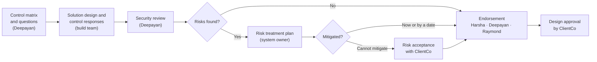
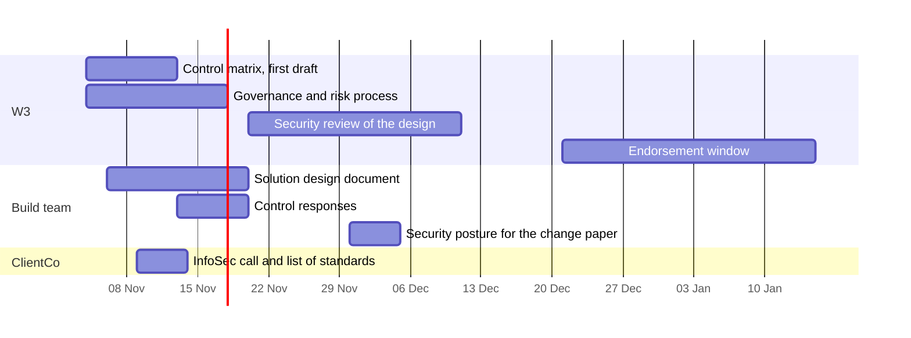

# Security and Compliance: Living Knowledge Document

**What this is.** The single record of the security and compliance work for the product: the standing position, the decisions, the plan, the open items and the actions. Each W3 security meeting updates it. The meeting log in §9 keeps what each meeting said.

**Owner.** Head of product engineering, with the W3 security lead.
**Status.** Internal. NTT DATA only.
**Last true as of:** 4 November 2026 (meeting M01).

**Sources.**
- M01: `ws2-technical/context/coyote_w3_security_and_compliance_workstream.vtt`
- Read against: `CONTEXT.md` · `ws2-technical/ClientCo_Tech_QA_28Oct_Notes.md` · `ws1-product/context/knowledge/K3_Architecture_and_Decisions.md` (TD9) · `ws2-technical/Compliance_Obligations_MVP_Notes.md`

---

## How to Update This Document

Do these steps after each security meeting:

1. Add a new meeting record to §9, with the next number (M02, M03, ...). Keep the earlier records as they are.
2. Change the standing position in §1 to §3 in place. Do not add a second version of a line.
3. Add new decisions to §4. If a decision replaces an earlier one, mark the earlier one "Replaced by D-SEC-nn". Do not delete it.
4. Add new open items to §5. Mark a closed item "Closed" with the meeting that closed it.
5. Add new actions to §6. Change the status of the actions that the meeting reported on.
6. Change §7 (the plan) and §8 (the effect on other documents) if the meeting changed them.
7. Change **Last true as of** and the change history in §11.

Mark a position **[H]** until the people who must agree have agreed it.

---

## 1. The People

| Person | Organisation | Role in the security work | Source |
|---|---|---|---|
| Deepayan Chanda | NTT DATA | W3 security lead. Builds the control matrix, the governance process and the risk process. Reviews the design. First endorser | M01 |
| Raymond Lie | NTT DATA security practice | Second endorser (tentative). Reviews and approves the final security document. Gives the risk rating framework | M01, 00:15:36 |
| Mohsen Pourghorbani Dinachali | NTT DATA security practice | Security technology: works with the build teams on the technology choice, the vendor choice and the detailed design of the security controls. Not an endorser | M01, 00:03:03 and 00:38:08 |
| Harsha Kodlaya | NTT DATA | Head of product engineering. Engineering lead in the approval chain. Acts for the Chief Solution Architect until that person joins. Owns the solution design and the control responses | M01, 00:15:14 |
| Raunaq Kumar | NTT DATA | Lead product manager. Drives the ClientCo engagement and the sprint plan baseline | M01 |
| Muniraju N | NTT DATA | Chief Scrum Master. Organises the meetings, sends the summary and tracks the dates | M01, 00:41:23 |
| Marius | NTT DATA | Pre-sales (Raymond, 00:14:11). Looks for a solution architecture document template. Not the governance approver | M01 |
| Nils | NTT DATA | Cloud architect. Interface to Mohsen | M01, 00:03:32 |
| Atul | NTT DATA | Data architect. Interface to Mohsen for data security | M01, 00:03:47 |
| Chief Solution Architect | NTT DATA | To join. Coordinates the design and the risk treatment plans. Not an approver | M01, 00:16:04 |

Raymond said that the security practice gives Deepayan and Mohsen at this stage, and gives more people if the work needs them (00:02:40).

---

## 2. The Approach

### 2.1 One control matrix from the applicable standards

The W3 security lead builds one control matrix for the product. It holds the unique controls from all the standards that apply in Australia.

- The full list has 11 standards with about 1,629 controls (00:23:30). The Australian ISM is the largest part, with about 1,100 controls (00:25:04). APRA standards are in the list.
- Many controls overlap. The matrix keeps the unique controls only: about 150 to 200 (00:11:30).
- Each control in the matrix maps to the standards that it meets. One control can map to four standards.
- Two items are out of this phase:
  - "SOC Act" (as the transcript says; SOC 2 or SOX is to confirm). It applies in production, and it adds about 26 controls then.
  - OWASP. It is a set of good practices, and the other standards cover most of its application security controls.
- The full list of the 11 standards is to confirm (open item O-SEC-01).

The controls are prescriptive. For example: "store each secret key in a key vault", or "use TLS 1.3" (00:26:00).

**Who sees what.** The mapping chart stays with Deepayan, Raymond and Harsha. The build teams get only the control questions, so that they answer the questions and do not need to read the mapping (00:23:30, 00:36:33). Mohsen gets the matrix for information (00:38:21).

**MVP first.** The matrix covers the MVP. For production, the controls change by a small delta, because the infrastructure stays the same (00:12:41).

### 2.2 What the build team gives to W3

| Document | Content | Who fills it |
|---|---|---|
| **High-level solution design document** | The architecture, the systems that the product integrates with, and the controls in the design. The template is to confirm (O-SEC-03) | Harsha and the build team |
| **Control questionnaire** | For each control: yes, no or not applicable, with one to three lines of justification if the control is not met (00:33:40) | The engineering and development team. One person or the full team |

The two documents can come together or one after the other. W3 starts the review when it has both (00:35:11). The sooner the team gives them, the sooner the review starts.

### 2.3 The build does not wait for security

The build team builds in parallel with the security review. The condition is: **no go-live without the final security endorsement** (Deepayan, 00:34:18). Deepayan expects the endorsement between the end of December and mid-January. Changes that the review finds then have time to go into the build (00:34:41).

Harsha described the flow (00:34:48):

1. The team writes the solution design.
2. W3 reviews it.
3. The build starts.
4. Through the build, the team checks that each control is in place in the architecture, in the cloud or in the code.

---

## 3. Governance, Risk and Endorsement

### 3.1 The endorsement chain

Three people endorse the security design (00:15:58):

1. **Harsha**, as the engineering lead for the system.
2. **Deepayan**, as the W3 security lead.
3. **Raymond**, as the second security reviewer (tentative). Deepayan does not approve his own work alone (00:15:33).

The endorsement has two results (00:16:17):

- **No risks found.** Deepayan and Raymond endorse the design.
- **Risks found.** Each risk gets a rating (high, medium or low). The owner gives a risk treatment plan. The design is endorsed with conditions, or without conditions, after the review (00:29:07).

Mohsen is not in the endorsement, because he works on the design of the controls (Raymond, 00:38:16).

### 3.2 The risk process

Deepayan builds the risk management process as part of the security architecture governance (00:16:50).

- **Rating.** Likelihood against impact gives high, medium or low. The rating uses the NTT DATA enterprise risk framework, so that the meaning of each level is the same as in the enterprise (00:27:21). Raymond gives the framework and the templates (O-SEC-05 for the ClientCo framework).
- **Example.** A control asks for TLS 1.3 and the product uses TLS 1.2. An auditor checks line by line, so this is a risk. It is low, or medium if the server is exposed to the internet and holds sensitive data (00:26:07).
- **Owner.** The system owner gives the treatment plan, and the data owner in some cases. The Chief Solution Architect coordinates the plans. The project sponsor is not the owner (00:14:46).
- **Treatment.** The owner says whether the risk is mitigated now, will be mitigated by a date (for example at go-live), or cannot be mitigated. If it cannot be mitigated, the risk goes to ClientCo for acceptance.
- **Closure.** The fix and the plan are documented, and a named person signs off. The reviewer asks the owner to show how the fix works (00:28:31). A mitigated risk stays in the record as mitigated.
- **Evidence.** Deepayan does not plan formal evidence capture for the endorsement. He expects it only for an IRAP assessment (00:28:02). What evidence the product keeps is to confirm (O-SEC-06).

### 3.3 ClientCo engagement

| When | What | Source |
|---|---|---|
| **Now** | Get the list of standards that ClientCo applies, at a high level for the MVP. W3 compares it with the list of 11 | Deepayan, 00:10:37 |
| **Soon** | A separate call with ClientCo InfoSec: introduce the governance process, agree a cadence, and learn the ClientCo cybersecurity approval process. Deepayan attends. The joint steering committee is not the place for this call | Raunaq, 00:19:06 and 00:21:42 |
| **Early December** | The change paper. The security posture must be ready: the architecture, the systems that the product integrates with, and the controls in the design | Harsha, 00:20:36 [H] |
| **When a risk cannot be mitigated** | ClientCo accepts the risk, for example "accepted for the MVP, fixed for production" | Deepayan, 00:17:25 |
| **When the design is clean** | ClientCo approves the design | Deepayan, 00:18:01 |

The same governance process applies to the MVP, to production and to later clients. It changes by about 5 to 10 per cent as it matures (00:19:49).

---

## 4. Decision Register

| ID | Decision | Who | Date | Status |
|---|---|---|---|---|
| D-SEC-01 | W3 builds one control matrix of the unique controls from the standards that apply in Australia, mapped to each standard | Deepayan; in Raunaq's recap | 4 Nov (M01) | Agreed |
| D-SEC-02 | "SOC Act" and OWASP are out of the control matrix for this phase | Deepayan | 4 Nov (M01) | Agreed |
| D-SEC-03 | The mapping chart stays with Deepayan, Raymond and Harsha. The build teams answer the control questions only | Deepayan | 4 Nov (M01) | Agreed |
| D-SEC-04 | The security endorsement chain is Harsha, Deepayan and Raymond | Deepayan and Raymond, with Harsha | 4 Nov (M01) | **[H]** Raymond is tentative |
| D-SEC-05 | Mohsen works with the build teams on the technology and the design of the controls, and is not an endorser | Raymond; Mohsen and Deepayan agreed | 4 Nov (M01) | Agreed |
| D-SEC-06 | The build team gives W3 a high-level solution design document and the control responses. W3 reviews when it has both | Deepayan; Harsha agreed | 4 Nov (M01) | Agreed |
| D-SEC-07 | The build runs in parallel with the security review. No go-live without the final endorsement | Deepayan; Harsha agreed | 4 Nov (M01) | Agreed |
| D-SEC-08 | Risks are rated on the NTT DATA enterprise risk framework | Deepayan and Raymond | 4 Nov (M01) | Agreed |
| D-SEC-09 | ClientCo approves at two points only: risk acceptance and the final design approval. Until then, W3 asks ClientCo only for the list of applicable standards | Deepayan; Raunaq agreed, with D-SEC-10 | 4 Nov (M01) | Agreed |
| D-SEC-10 | NTT DATA holds a separate, early call with ClientCo InfoSec to start the engagement. Deepayan attends | Raunaq; Deepayan and Harsha agreed | 4 Nov (M01) | Agreed |

---

## 5. Open Items

| ID | Open item | Owner | By when | Status |
|---|---|---|---|---|
| O-SEC-01 | The full list of the 11 standards, and the standards that ClientCo applies for the MVP | Deepayan, with ClientCo InfoSec | To confirm | Open |
| O-SEC-02 | Whether NIST 800-53 stays the anchor of the one control set (TD9 [H], K3), or the matrix of 11 standards replaces it | Harsha, with Deepayan | To confirm | Open |
| O-SEC-03 | The template of the high-level solution design document: Marius's template, Deepayan's template, or a new one | Deepayan | About 6 Nov | Open |
| O-SEC-04 | "SOC Act" in the transcript: SOC 2 or SOX | Deepayan | To confirm | Open |
| O-SEC-05 | The ClientCo risk rating framework, and how it relates to the NTT DATA framework | Deepayan, with ClientCo InfoSec | To confirm | Open |
| O-SEC-06 | Evidence: Deepayan expects formal evidence only for an IRAP assessment. Agree what evidence the product keeps, and whether IRAP applies | Harsha, with Deepayan | To confirm | Open |
| O-SEC-07 | The meaning of "go-live" in D-SEC-07: the ClientCo sandbox in January, or production | Harsha, with Deepayan | To confirm | Open |
| O-SEC-08 | The architecture principles of ClientCo, if they exist. NTT DATA has no enterprise set (Raymond, Mohsen). Deepayan said the work can continue without them | Harsha, with ClientCo | To confirm | Open |
| O-SEC-09 | Whether the security practice adds people later | Raymond | When the need is clear | Open |

---

## 6. Action Register

| ID | Action | Owner | When | Source | Status |
|---|---|---|---|---|---|
| A-SEC-01 | Build the first draft of the control matrix and the control questions | Deepayan | About 11 to 13 Nov ("a week, week and a half") | M01, 00:25:28 and 00:38:33 | Open |
| A-SEC-02 | Find and sanitise the solution architecture document template | Marius (reported by Deepayan) | About 6 Nov ("a day or two") | M01, 00:29:33 and 00:33:26 | Open |
| A-SEC-03 | If Marius has no template, share Deepayan's own template | Deepayan | After A-SEC-02 | M01, 00:32:56 | Open |
| A-SEC-04 | Give Deepayan the NTT DATA risk rating framework and the templates | Raymond | To confirm | M01, 00:27:11 | Open |
| A-SEC-05 | Write the security governance process: review, risk treatment, endorsement and ClientCo approvals | Deepayan | To confirm | M01, 00:19:33 | Open |
| A-SEC-06 | Set up the call with ClientCo InfoSec, with Deepayan | Raunaq (to confirm) | Soon | M01, 00:19:06 and 00:39:27 | Open |
| A-SEC-07 | Ask ClientCo for the list of standards that apply to the MVP | Owner to confirm; in the call of A-SEC-06 | With A-SEC-06 | M01, 00:10:37 | Open |
| A-SEC-08 | Add Mohsen to the governance call | Muniraju | Before 5 Nov | M01, 00:04:36 | Open |
| A-SEC-09 | Introduce Mohsen to Nils, Atul and Vishnu (A2 pod lead) at the pod leads call | Harsha | 5 Nov | M01, 00:04:06 | Open |
| A-SEC-10 | Send the meeting summary with tentative dates. The team agrees the dates to close the sprint plan baseline | Muniraju, with Deepayan for the dates | To confirm | M01, 00:41:23 and 00:41:39 | Open |
| A-SEC-11 | Write the high-level solution design document in the agreed template | Harsha, with the build team | After A-SEC-02 or A-SEC-03 | M01, 00:39:27 | Open |
| A-SEC-12 | Answer the control questions | Harsha, with the build team | After A-SEC-01 | M01, 00:39:27 | Open |
| A-SEC-13 | Share the control matrix with Mohsen for information | Deepayan | When ready | M01, 00:38:29 | Open |
| A-SEC-14 | Have the security posture ready for the change paper | Harsha | Early December | M01, 00:20:36 (said in passing) | Open |
| A-SEC-15 | Put names in place of titles in the approval workflow | Deepayan | With A-SEC-05 | M01, 00:41:05 | Open |

---

## 7. The Plan

The dates are indicative. They come from the durations in M01 and are to confirm in the summary of A-SEC-10.

| Milestone | When | Source |
|---|---|---|
| Template for the solution design document | About 6 Nov | M01 |
| Control matrix, first draft | About 11 to 13 Nov | M01 |
| Architecture and high-level solution design | End of Sprint 1, the third week of November | ClientCo Q&A, 28 Oct |
| Both documents with W3 | Two to three weeks from 4 Nov, depending on the design | M01, 00:12:41 |
| Security posture for the change paper | Early December | M01, Harsha [H] |
| ClientCo InfoSec ruling on the release path | About 12 December | `CONTEXT.md` §8 |
| Final security endorsement | End of December to mid-January | M01, 00:34:18 |
| ARB, cyber, privacy and GTS reviews at ClientCo | From January | ClientCo Q&A, 28 Oct |

---

## 8. Effect on Other Documents

| Document | What M01 said | Effect | What to change |
|---|---|---|---|
| `CONTEXT.md` §8: ClientCo InfoSec | Separate InfoSec call, the standards list, endorsement end of December to mid-January | Add | Done on 4 Nov |
| K3 TD9: "one control set on NIST 800-53, mapped to ISO 27001, SOC 2 and CPS 234" | One control set, built from 11 standards | To confirm | After O-SEC-02 |
| ClientCo Q&A notes, 28 Oct: nine mandatory controls and the change papers | Not discussed. The change paper needs the security posture in early December | Confirmed | — |

---

## 9. Meeting Log

### M01 · W3 Security and Compliance Workstream, 4 November 2026

**What this was.** The first meeting of the W3 security and compliance workstream with the security practice. It followed a call on 3 November between Deepayan, Muniraju and Raunaq. It agreed the security approach, the governance and the plan for the sprint.
**Source.** `ws2-technical/context/coyote_w3_security_and_compliance_workstream.vtt` (42 minutes)
**Present.** Deepayan Chanda (NTT DATA, W3 security lead) · Raymond Lie (NTT DATA security practice) · Mohsen Pourghorbani Dinachali (NTT DATA security practice, from 00:31:46) · Harsha Kodlaya (NTT DATA, head of product engineering) · Raunaq Kumar (NTT DATA, lead product manager) · Muniraju N (NTT DATA, Chief Scrum Master). Marius was invited and did not join.

**The meeting in five lines.**

1. Deepayan builds one control matrix of about 150 to 200 unique controls from 11 standards (about 1,629 controls). The first draft is due in about a week and a half.
2. The build team gives W3 a high-level solution design document and answers to the control questions. W3 reviews when it has both.
3. Harsha, Deepayan and Raymond endorse the security design. Risks get a rating and a treatment plan from the system owner.
4. ClientCo approves at two points: risk acceptance and the final design. A separate ClientCo InfoSec call starts the engagement soon.
5. The build does not wait for security. No go-live without the endorsement, expected between the end of December and mid-January.

**Talking points.**

| # | Topic | What was said | Who |
|---|---|---|---|
| 1 | Allocation | Deepayan and Mohsen are on the project now. More people if the work needs them | Raymond, 00:02:40 |
| 2 | Mohsen's role | Technology choice, vendor choice, detailed design of the controls, with the engineering teams. Nils and Atul are his interfaces | Raymond, 00:03:03; Harsha, 00:03:32 |
| 3 | Plan from the call of 3 November | Security controls with the North Star in mind, MVP dates kept, ClientCo approvals when they are needed | Raunaq, 00:06:41 |
| 4 | ClientCo now | Only the list of applicable standards. No approvals now | Deepayan, 00:10:37 |
| 5 | Control matrix | 11 standards, about 1,629 controls, the ISM about 1,100. About 150 to 200 after the merge. "SOC Act" and OWASP out | Deepayan, 00:22:23 |
| 6 | Approvers | Marius is pre-sales. The project sponsor is too senior. The system owner and the data owner own the risks | Raymond, Deepayan, 00:14:05 |
| 7 | Endorsement | Harsha, Deepayan, Raymond. The Chief Solution Architect coordinates and does not approve | Deepayan, 00:15:58 |
| 8 | ClientCo cadence | Meet ClientCo InfoSec soon, in a separate call, with Deepayan | Raunaq, 00:18:09 |
| 9 | Change paper | The security posture is ready for the change paper in early December | Harsha, 00:20:36 |
| 10 | Prescriptive controls and risk | The TLS 1.2 against TLS 1.3 example. Rating on the NTT DATA enterprise framework | Deepayan, Raymond, 00:26:00 |
| 11 | Evidence | Formal evidence only for IRAP. A documented fix and a sign-off close a risk | Deepayan, 00:27:57 |
| 12 | Design document | A high-level solution design document. Marius looks for a template. Deepayan has his own. NTT DATA has no standard template (Mohsen) | Deepayan, Mohsen, 00:29:33 |
| 13 | Architecture principles | NTT DATA has no enterprise set. ClientCo may have one. Not necessary for now | Deepayan, Raymond, 00:30:06 |
| 14 | Parallel build | Build now; no go-live without the endorsement | Deepayan, 00:34:18 |
| 15 | Security by design | Mohsen gets the matrix for information, so that security is in the design from the start | Mohsen, 00:38:48 |
| 16 | Recap | Matrix and template in parallel with the ClientCo call. Harsha fills both documents. W3 reviews. Then ClientCo approval | Raunaq, 00:39:27 |

---

## 10. Terms

| Term | Meaning |
|---|---|
| **Control matrix** | The list of unique security controls for the product, each mapped to the standards that it meets |
| **Control questions** | The controls written as questions for the build team. The answer is yes, no or not applicable, with a justification |
| **Endorsement** | The security sign-off of the design by the endorsement chain |
| **High-level solution design document** | The design document that records the architecture, the integrations and the controls in the design |
| **IRAP** | Infosec Registered Assessors Program: an Australian assessment against the ISM |
| **ISM** | The Australian Government Information Security Manual |
| **Risk treatment plan** | The owner's plan for a risk: mitigated now, mitigated by a date, or sent for acceptance |
| **Risk acceptance** | The decision to accept a risk that cannot be mitigated. ClientCo makes it for the product |
| **System owner** | The person who is responsible for the system and gives the risk treatment plan |

---

## 11. Change History

| Date | Meeting | Sections | Description |
|---|---|---|---|
| 4 Nov 2026 | M01 | All | First version, from the W3 security and compliance workstream meeting |
