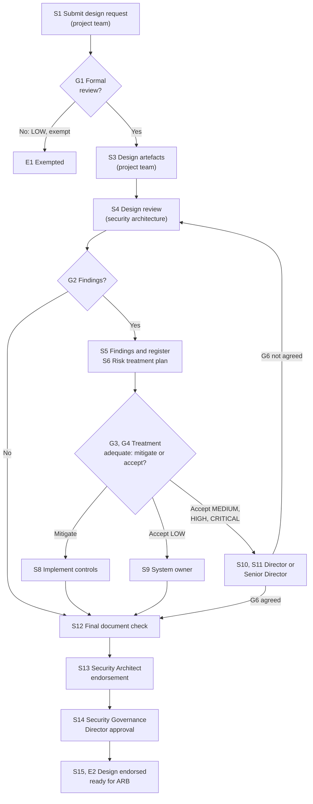
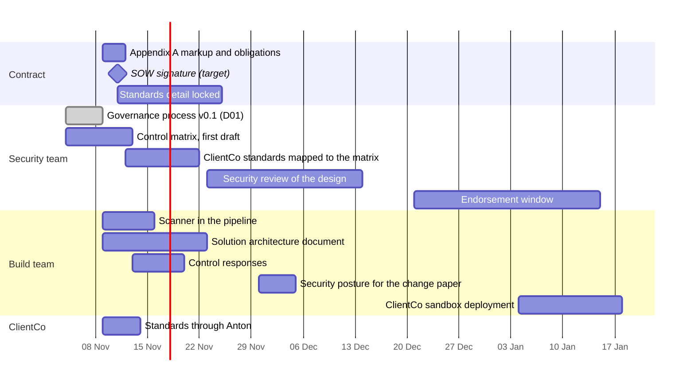

# Security and Compliance: Living Knowledge Document

**What this is.** The single record of the security and compliance work for the product: the standing position, the governance process, the contract position, the decisions, the plan, the open items and the actions. Each security meeting and each security document updates it. The log in §10 keeps what each meeting and document said.

**Owner.** Head of product engineering, with the W3 security lead.
**Status.** Internal. NTT DATA only.
**Last true as of:** 9 November 2026 (meeting M02 and document D01).

**Sources.**
- M01: `ws2-technical/context/coyote_w3_security_and_compliance_workstream.vtt` (4 Nov)
- D01: `ws2-technical/security/Security_Architecture_Design_Review_Process_Summary_v0.1.pdf` and `Security_Architecture_Design_Review_NTT.v0.1.jpeg` (v0.1 draft, 4 Nov, received 9 Nov)
- M02: `ws2-technical/security/transcript_coyote_aligment_0911.docx` (9 Nov), with the AI notes `transcript_coyote_aligment_notes_0911.docx`
- Read against: `CONTEXT.md` · `ws2-technical/ClientCo_Tech_QA_28Oct_Notes.md` · `ws1-product/context/knowledge/K3_Architecture_and_Decisions.md` (TD9) · `ws2-technical/Compliance_Obligations_MVP_Notes.md`

---

## How to Update This Document

Do these steps after each security meeting or document:

1. Add a new record to §10, with the next number (M03 for a meeting, D02 for a document). Keep the earlier records as they are.
2. Change the standing position in §1 to §4 in place. Do not add a second version of a line.
3. Add new decisions to §5. If a decision replaces an earlier one, mark the earlier one "Replaced by D-SEC-nn". Do not delete it.
4. Add new open items to §6. Mark a closed item "Closed" with the meeting or document that closed it.
5. Add new actions to §7. Change the status of the actions that the meeting reported on.
6. Change §8 (the plan) and §9 (the effect on other documents) if the meeting changed them.
7. Change **Last true as of** and the change history in §12.

Mark a position **[H]** until the people who must agree have agreed it.

---

## 1. The People

| Person | Organisation | Role in the security work | Source |
|---|---|---|---|
| Deepayan Chanda | NTT DATA, security consultant under contract (Marius, M02) | W3 security lead. Author of the governance process (D01). Builds the control matrix and the risk process. Reviews the design. Probably the Lead Security Architect in D01 **[H]** | M01, D01, M02 |
| Raymond Lie | NTT DATA security practice | Second security reviewer. Redrafts the security clauses in Appendix A of the SOW. Maps the ClientCo standards to the control matrix. Worked in the ClientCo InfoSec team for about a year | M01; M02, 00:24:12 |
| Marius Muller | NTT DATA | Security leader for the deal: accepts or rejects the security clauses of the MSA and the SOW for NTT DATA. Engages Deepayan. Wrote the board-level paper on the compliance obligations. M01 called him pre-sales. Exact title to confirm | M02 |
| Mohsen Pourghorbani Dinachali | NTT DATA security practice | Security technology: the technology choice, the vendor choice, the design of the controls, and the tool recommendations. Not an endorser | M01; M02, 00:47:01 |
| Harsha Kodlaya | NTT DATA | Head of product engineering and technical lead. Owns the solution design and the control responses. Acts for the Chief Solution Architect until that person joins. Approves the risk treatment plans for development and engineering (D-SEC-20) | M01, M02, D01 email |
| Paul Sommerin | NTT DATA | Overall lead of the deal. Owns the risk of the deal | M02, 00:44:25 |
| Pratik Khandwala | NTT DATA | Delivery lead. Owns the SOW drafts and the touchpoints | M02 |
| Anant Bagri | NTT DATA | Deal strategy lead. Holds the ClientCo business relationship | M02 |
| Raunaq Kumar | NTT DATA | Lead product manager. Drives the ClientCo engagement and the sprint plan baseline | M01 |
| Muniraju N | NTT DATA | Chief Scrum Master. Organises the meetings, sends the summary and tracks the dates | M01 |
| Nils | NTT DATA | Cloud architect. Interface to Mohsen | M01 |
| Atul | NTT DATA | Data architect. Interface to Mohsen for data security | M01 |
| Chief Solution Architect | NTT DATA | To join. Coordinates the design and the risk treatment plans | M01 |
| Anton | AWS | Lead solution architect for ClientCo. Sits at ClientCo five days a week. The first route to the ClientCo security standards and the ClientCo security people | M02, 00:04:47 |

**ClientCo side.** NTT DATA works with the ClientCo business. A central ClientCo cyber team manages the security controls and requirements. NTT DATA has no direct contact with that team yet. Anton is the route to it (Anant, M02, 00:03:32).

---

## 2. The Approach

### 2.1 The control baseline

**The standards.** D01 names 11 standards in the scope of the assessment:

| # | Standard |
|---|---|
| 1 | APRA CPS 234 |
| 2 | APRA CPS 230 |
| 3 | Cyber Security Act 2024 |
| 4 | ASD Essential Eight, maturity level 2 |
| 5 | ASD ISM (September 2026) |
| 6 | Privacy Act, APP 11 |
| 7 | NIST CSF 2.0 |
| 8 | ISO 27001:2022 clauses |
| 9 | ISO 27002:2022 controls |
| 10 | ISO 27016 (technical report) |
| 11 | ISO 27701 (privacy information management) |

The assessment also covers security good practice, the policies that apply, the approved patterns (when the solution architecture builds them) and risk identification.

**The control matrix.**

- M01: the 11 standards hold about 1,629 controls. The ISM is about 1,100 of them. The matrix keeps the unique controls only: about 150 to 200.
- M02 (Marius, 00:41:44): the first matrix had about 180 controls on NIST. It then moved to ISO 27001. It leaves out the physical and personnel controls, because AWS or ClientCo give them.
- Marius said that this reduced matrix may not satisfy APRA in full. If the platform counts as critical infrastructure, about 280 controls apply. He preferred the CCM (as heard; probably the CSA Cloud Controls Matrix) as the baseline, but it takes longer (00:42:25).
- Each control maps to the standards that it meets. The controls are prescriptive, for example "use TLS 1.3".
- **Who sees what.** The mapping chart stays with Deepayan, Raymond and Harsha. The build teams answer the control questions only (D-SEC-03).

**The next step (M02).**

1. ClientCo gives its standards: its own policies and the regulatory standards that apply, for example APRA CPS 230 and ISO 27001.
2. Raymond compares them with the control matrix. He adds what is missing, and marks each control as MVP, later, or out.
3. The team plans the controls into the sprints.

**Start from the full list (D-SEC-13).** Paul: start with the most complete list of controls. Remove a control only when ClientCo confirms that the MVP does not need it. This shows the security target and the time that it takes (00:44:25).

### 2.2 What the build team gives to the security team

| Document | Content | Source |
|---|---|---|
| **Intake form** (D01 step S1) | Project, sponsor, scope, data classification, timeline, priority | D01 |
| **Design artefacts** (D01 step S3) | The solution architecture document (SAD), data flow diagrams with trust zones and data classification, network topology, threat model, vendor assessments where they apply, access control model, encryption design | D01 |
| **Control questionnaire** | For each control: yes, no or not applicable, with one to three lines of justification if the control is not met | M01 |
| **Risk treatment plan** (D01 step S6) | For each finding: mitigate, accept, transfer or avoid (§3.3) | D01 |

Harsha gives the detailed solution architecture document to Marius and Raymond in about two weeks from 9 November (M02, 00:41:21).

### 2.3 The build runs in parallel with the review

The build does not wait for the security review. There is no go-live without the final security endorsement (D-SEC-07). Deepayan expects the endorsement between the end of December and mid-January.

M02 added two points:

- Controls that only the ClientCo environment needs can go into the sprints of January and February, when the product moves to the ClientCo environment. The team prioritises the sprints with Deepayan (Pratik, 00:45:40).
- From the ClientCo sandbox deployment in January, the product must meet all the ClientCo standards (Harsha, 00:03:07).

### 2.4 The build environment and the data

- The build uses AWS accounts that the NTT DATA AWS practice provisioned. The accounts passed the NTT DATA internal provisioning process. They are bare: the controls go in as the team builds each component (Harsha, 00:14:12).
- The team designs a landing zone that meets the ClientCo needs now and the SaaS needs later (Harsha, 00:14:31).
- The build environment holds no ClientCo live data. It holds synthetic data and redacted samples only. Integration with ClientCo live data starts in the ClientCo sandbox, from about January (D-SEC-15).

### 2.5 Security tooling

- A code and vulnerability scanner is in the pipeline from now, so that the code gets no new vulnerabilities (Marius, 00:46:19).
- The team uses the AWS APRA workbook and its design patterns as design guidance (Marius named it as "CPS 230"; AWS also has a CPS 234 workbook; to confirm).
- Mohsen, with Deepayan, recommends the tools: code scanners, antivirus scanners for documents, and prompt-injection protection. The team puts them into the pipelines (Harsha, 00:47:01).
- The security team gives **recommendations** for tools. Approval is a different step. Pratik said that an earlier request was read as a request for approval (00:47:25).

### 2.6 ClientCo controls and equivalent controls

ClientCo has its own vendor technologies and security controls. In the ClientCo environment, ClientCo can ask the product to use them. Where the product uses an equivalent control, ClientCo must accept the equivalence. The product after the MVP must not depend on ClientCo licences or tools (Raymond, 00:21:56). This is to discuss with ClientCo (O-SEC-13).

---

## 3. Governance: the Security Architecture Design Review Process

D01 is the governance process that Deepayan wrote (v0.1 draft, 4 November). It says how a solution design for the product is submitted, triaged, reviewed, risk-treated and endorsed before the Security Architecture Governance submission. Deepayan asked Harsha for questions on it, and for the name of the approver of the risk treatment plans for development and engineering. Harsha is the approver (D-SEC-20). §3.6 lists the questions for Deepayan.

### 3.1 Triggers, scope and lanes

- **Triggers.** A project registration, a change request, or a referral from the architecture forum.
- **Exemption.** A LOW-tier request that meets the exemption criteria leaves at triage. The triage record is kept.

| Lane | Responsibilities |
|---|---|
| **Business, project, development and engineering team** | Submits the design review request. Gives the design artefacts. Prepares the risk treatment plan. Implements the mitigations. Receives the endorsement and goes to the approved build |
| **Security architecture team** | Triages and classifies (Lead Security Architect). Reviews the design. Finds the issues and risks, and updates the risk register. Reviews the risk treatment plan. Records the risk acceptance. Does the final document check. Gives the Security Architect endorsement and issues the endorsement record |
| **Risk and governance** | The project and business Director approves MEDIUM and HIGH risk acceptance. The project and business Senior Director approves CRITICAL risk acceptance. The Security Governance Director approves before the design endorsement is issued |

### 3.2 The process

| Step | Owner | Output or route |
|---|---|---|
| S1 Submit the design request | Project team | The intake form (§2.2) |
| S2 Triage and classify | Security architecture | The triage record |
| G1 Formal review needed? | Security architecture | HIGH or MEDIUM impact (a new application or a change to an existing one): go to S3. LOW and exempt: E1 |
| S3 Give the design artefacts | Project team | The artefacts in §2.2 |
| S4 Review and assess the design | Security architecture | Review against the standards, the security principles, the approved patterns, maturity (1 to 5 for each domain) and the known threats. The draft review report and the risk register. G6 returns here |
| G2 Findings? | Security architecture | Yes: S5. No: S12 |
| S5 Issue the findings and the risk register | Security architecture | The final review report. The risk register, with finding ID, component, severity, standard breached, recommended treatment and target date |
| S6 Give the risk treatment plan | Project team | For each finding: mitigate, accept (rationale, compensating controls, expiry), transfer or avoid. G3 returns here |
| S7 Review the risk treatment plan | Security architecture | Confirms that the findings are addressed, the mitigations are adequate and the acceptance is proportionate. The list for senior acceptance |
| G3 Treatment adequate? | Security architecture | Yes: G4. No: back to S6 |
| G4 Mitigated or accepted? | Security architecture | Mitigated: S8. Accepted LOW: S9. Accepted MEDIUM, HIGH or CRITICAL: G5 |
| S8 Implement the controls | Project team | The controls are in place and the design is updated. Then S12 |
| S9 LOW risk approved by the system owner | Security architecture | The system owner's acceptance is recorded. Then S12 |
| G5, S10, S11 Risk acceptance | Risk and governance | MEDIUM and HIGH: the project Director (S10). CRITICAL: the project Senior Director (S11). A signed risk acceptance record, and the register is updated |
| G6 Agreement on the treatment? | Risk and governance | Yes: S12, with conditional items tracked. No: the endorsement is held, and the design goes back to S4 |
| S12 Final document check | Security architecture | The verified set: report, register, risk treatment plan, acceptance records, artefacts |
| S13 Security Architect endorsement | Security architecture | The recommendation: Full, Conditional or Withheld. A peer endorsement by the Security Architecture Director |
| S14 Security Governance Director approval | Risk and governance | The governance approval is recorded |
| S15 Issue the endorsement | Security architecture | The endorsement record. E2: the design is endorsed and ready for the ARB submission |

### 3.3 Risk acceptance authority

| Severity | Route | Accepts the risk |
|---|---|---|
| LOW | S9 | System owner (architect) |
| MEDIUM | G5 to S10 | Project Director |
| HIGH | G5 to S10 | Project Director |
| CRITICAL | G5 to S11 | Project Senior Director |

Each accepted risk has a rationale, compensating controls, an accepting risk owner and an expiry date. The risk is reviewed again when it expires.

**Rating.** The rating uses the NTT DATA enterprise risk framework, with likelihood against impact (D-SEC-08). D01 uses four levels: LOW, MEDIUM, HIGH and CRITICAL. M01 talked of three. Raymond gives the framework and the templates (A-SEC-04).

**Example (M01).** A control asks for TLS 1.3 and the product uses TLS 1.2. This is a LOW risk, or MEDIUM if the server is open to the internet and holds sensitive data.

**Closure (M01).** A documented fix and a sign-off by a named person close a risk. The reviewer asks the owner to show how the fix works. A mitigated risk stays in the register as mitigated.

### 3.4 Endorsement outcomes

| Outcome | Criteria | Effect |
|---|---|---|
| **Full** | All criteria met. No open items | The design goes on to the Security Architect |
| **Conditional** | Open items with agreed fix dates | The design goes on. The open items are obligations in the risk register |
| **Withheld** | Blocking findings remain | The design stops. The team fixes the findings and submits again at S4 |

### 3.5 What D01 changes in the M01 position

| Subject | M01 position | D01 | Status |
|---|---|---|---|
| Endorsement | Harsha, Deepayan and Raymond endorse (D-SEC-04) | The Security Architect endorses (S13), with a peer endorsement by the Security Architecture Director. The Security Governance Director approves (S14) | Names for each role to confirm (O-SEC-11) |
| Risk acceptance | A risk that cannot be mitigated goes to ClientCo for acceptance (D-SEC-09) | The system owner accepts LOW. The project Director accepts MEDIUM and HIGH. The project Senior Director accepts CRITICAL | Where ClientCo accepts a risk is to confirm (O-SEC-11) |
| ClientCo | ClientCo approves the final design | E2: the endorsed design is ready for the ARB submission. The ClientCo ARB, cyber and privacy reviews start in January (ClientCo Q&A, 28 Oct) | Consistent |
| Risk levels | High, medium, low | LOW, MEDIUM, HIGH, CRITICAL | D01 applies |
| Treatment options | Mitigate now, mitigate by a date, or accept | Mitigate, accept, transfer or avoid | D01 applies |
| Engineering role | Harsha is the engineering lead in the approval chain | The project team prepares the risk treatment plan. Harsha approves it for development and engineering | Agreed (D-SEC-20) |

### 3.6 Questions for Deepayan on D01

Harsha sends these with the reply of A-SEC-27. Record each answer here, and change §3 and §6 to match.

| # | Question | Why it matters | Answer |
|---|---|---|---|
| Q1 | Who fills each D01 role: the system owner, the Lead Security Architect, the project Director, the project Senior Director, the Security Architecture Director and the Security Governance Director? | The approvals need names (O-SEC-11, A-SEC-15) | To come |
| Q2 | Does "project side" mean NTT DATA, ClientCo or both? | It sets who accepts MEDIUM, HIGH and CRITICAL risks | To come |
| Q3 | Where does ClientCo accept a risk now? In M01, a risk that cannot be mitigated went to ClientCo | D01 gives risk acceptance to the project Directors (§3.5) | To come |
| Q4 | Is the "SOC Act" of M01 the SOCI Act? Is the Cyber Security Act 2024 in the MVP scope? | It sets the control count for production (O-SEC-04) | To come |
| Q5 | What are the exemption criteria for a LOW-tier request? | Small changes in the sprints can then leave at triage | To come |
| Q6 | Which domains does the maturity score of 1 to 5 use, and which model? | The build team can prepare for the score | To come |
| Q7 | The SOW covers the build only (D-SEC-11), and the product moves to the ClientCo sandbox in January. Which changes in the sprints start a new review? | It sets the review load in each sprint | To come |
| Q8 | Where does the risk register live, and who can see it? | The build team updates the risk treatment plans there | To come |
| Q9 | How does the endorsed design (E2) go to the ClientCo ARB, and who submits it? | It links D01 to the ClientCo reviews from January | To come |

---

## 4. The Contract Position: SOW Appendix A

M02 found that the security terms of the MSA and the SOW do not match the MVP. The SOW must be signed within about 48 hours of 9 November.

### 4.1 What the contract says now

- The SOW says that NTT DATA stores, owns, controls, supports and manages a solution in the ClientCo environment (Marius, 00:26:43; Pratik confirmed).
- Appendix A holds the technology and information security standards. ClientCo copied it from a standard contract (Paul, 00:29:45).
- Appendix A asks NTT DATA for an annual independent ISO 27001 assessment, with the report to ClientCo (Marius, 00:28:24).
- The MSA asks NTT DATA to tell ClientCo of a security breach within 72 hours, or 48 hours for critical infrastructure or under APRA CPS 230. This needs a platform and a process to take in, monitor, detect and report incidents (Marius, 00:08:57).

### 4.2 The agreed direction

- **The SOW covers the build only.** Ownership, management and run are outside this SOW. Appendix A changes to match (D-SEC-11).
- **The NTT DATA obligations under the MVP need a definition.** After deployment, the product sends its logs to the ClientCo Security Operations Centre. Some obligations then belong to ClientCo, because NTT DATA has no visibility of the ClientCo controls. The MSA section must show what NTT DATA does under the MVP (Raymond, 00:21:56; O-SEC-12).
- **The environment sets the responsibility.** Until January, the build is in the NTT DATA environment, under NTT DATA standards and controls. From January, in the ClientCo environment, many controls belong to ClientCo: identity, the SOC, vulnerability management, code scanning and the secure development lifecycle (Marius, 00:01:41 and 00:09:38).
- **Three parties share the controls.** AWS, ClientCo and NTT DATA each own a part. The AWS shared responsibility model sets the AWS part. NTT DATA must define and evidence the controls it owns during the build and the support.
- **Build toward the standards. Certify later (D-SEC-12).** The MVP builds to ISO 27001 and the applicable standards. An independent certification needs the platform to operate for a period, about six months (Pratik, 00:34:36). There is probably no independent attestation by 30 April 2027 (Marius; Paul agreed). The certification follows when the product moves to its own AWS environment (Harsha, 00:35:11).
- **Time and materials.** The engagement is time and materials. ClientCo is open to a discussion of how the product meets its standards (Anant, 00:20:35).
- **Proposal: lock the detail after signature.** Anant proposed to describe the approach in the SOW now, and to lock the detailed standards one to two weeks after the signature (00:36:58). **[H]**

### 4.3 After the MVP

This sets which security obligations NTT DATA holds later. It is the current intent of the deal team, and is **[H]**.

- After a successful MVP, the product moves to its own operating entity. ClientCo becomes client zero and uses the product as a service (Anant, 00:30:57).
- NTT DATA continues to support the platform under a separate service contract, until the product runs at scale (Anant, 00:19:21; Paul, 00:32:01).
- The operating entity starts with a light management and product management team. The team grows with more clients. It holds the regulatory and compliance obligations in each region (Paul, 00:33:14).
- If NTT DATA owns, supports or manages the platform, NTT DATA holds the obligations of a SaaS provider, with an annual attestation (Marius, 00:27:41).

---

## 5. Decision Register

| ID | Decision | Who | Date | Status |
|---|---|---|---|---|
| D-SEC-01 | W3 builds one control matrix of the unique controls from the standards that apply in Australia, mapped to each standard | Deepayan; in Raunaq's recap | 4 Nov (M01) | Agreed. D01 names the 11 standards |
| D-SEC-02 | "SOC Act" and OWASP are out of the control matrix for this phase | Deepayan | 4 Nov (M01) | Agreed. "SOC Act" is to identify (O-SEC-04) |
| D-SEC-03 | The mapping chart stays with Deepayan, Raymond and Harsha. The build teams answer the control questions only | Deepayan | 4 Nov (M01) | Agreed |
| D-SEC-04 | The security endorsement chain is Harsha, Deepayan and Raymond | Deepayan and Raymond, with Harsha | 4 Nov (M01) | To review against D-SEC-19 (O-SEC-11) |
| D-SEC-05 | Mohsen works with the build teams on the technology and the design of the controls, and is not an endorser | Raymond; Mohsen and Deepayan agreed | 4 Nov (M01) | Agreed |
| D-SEC-06 | The build team gives the security team the solution design and the control responses. The review starts when it has both | Deepayan; Harsha agreed | 4 Nov (M01) | Agreed. D01 §2.2 adds the artefact list |
| D-SEC-07 | The build runs in parallel with the security review. No go-live without the final endorsement | Deepayan; Harsha agreed | 4 Nov (M01) | Agreed |
| D-SEC-08 | Risks are rated on the NTT DATA enterprise risk framework | Deepayan and Raymond | 4 Nov (M01) | Agreed |
| D-SEC-09 | ClientCo approves at two points only: risk acceptance and the final design approval | Deepayan; Raunaq agreed | 4 Nov (M01) | To review against D-SEC-19 (O-SEC-11) |
| D-SEC-10 | NTT DATA holds a separate, early call with ClientCo InfoSec. Deepayan attends | Raunaq; Deepayan and Harsha agreed | 4 Nov (M01) | Agreed. M02 adds Anton as the first route (D-SEC-14) |
| D-SEC-11 | The MVP SOW covers the build only. Ownership, management and run are outside it. Appendix A changes to match | Pratik; Marius, Raymond, Anant and Paul agreed | 9 Nov (M02) | Agreed |
| D-SEC-12 | The MVP builds toward ISO 27001 and the applicable standards. Independent certification comes after a period of operation, about six months, and is not expected by 30 April 2027 | Pratik and Marius; Paul agreed | 9 Nov (M02) | Agreed |
| D-SEC-13 | Start from the full control list. Remove a control only when ClientCo confirms that the MVP does not need it | Paul; Raymond, Harsha and Pratik agreed | 9 Nov (M02) | Agreed |
| D-SEC-14 | ClientCo standards come first through Anton. Raymond maps them to the control matrix | Raymond and Harsha; Pratik agreed | 9 Nov (M02) | Agreed |
| D-SEC-15 | The build environment holds no ClientCo live data: synthetic and redacted samples only. Live data starts in the ClientCo sandbox | Harsha; nobody disagreed | 9 Nov (M02) | Agreed |
| D-SEC-16 | A code and vulnerability scanner is in the pipeline now. The AWS APRA workbook is the design guidance | Marius; Pratik and Harsha agreed | 9 Nov (M02) | Agreed |
| D-SEC-17 | The security team recommends the security tools. Tool approval is a separate step | Pratik; Marius agreed | 9 Nov (M02) | Agreed |
| D-SEC-18 | Two tracks: Paul and Anant brief Marius on the product journey. Raymond works with ClientCo on the standards | Paul; Marius agreed | 9 Nov (M02) | Agreed |
| D-SEC-19 | The Security Architecture Design Review process (D01) is the governance process for the product | Deepayan | 9 Nov (D01) | **[H]** v0.1 draft. Deepayan asks for questions |
| D-SEC-20 | Harsha approves the risk treatment plans for development and engineering, with no other approver | Harsha, in reply to Deepayan | 9 Nov (D01) | Agreed |

---

## 6. Open Items

| ID | Open item | Owner | By when | Status |
|---|---|---|---|---|
| O-SEC-01 | The standards that ClientCo applies to the MVP: its policies and the regulatory standards. D01 names the 11 standards on the NTT DATA side | Harsha and Pratik, through Anton | This week (from 9 Nov) | Open. Updated in M02 |
| O-SEC-02 | The anchor of the control set. K3 TD9 says NIST 800-53. M02: the matrix started on NIST and moved to ISO 27001. D01 names NIST CSF 2.0 | Harsha, with Deepayan | To confirm | Open. Updated in M02 |
| O-SEC-03 | The template of the solution architecture document | Deepayan | Was about 6 Nov | Open. Draft SAD template from Harsha on 9 Nov: `ws2-technical/templates/Coyote_Solution_Architecture_Document_Template_v0.1.docx`, with the security artefacts in §10 and the appendices, for Deepayan to review |
| O-SEC-04 | "SOC Act" in M01. Probably the SOCI Act (Security of Critical Infrastructure Act 2018), because it applies in production and critical infrastructure came up in M02. D01 lists the Cyber Security Act 2024 separately | Deepayan | To confirm | Open. Updated in M02 |
| O-SEC-05 | The ClientCo risk rating framework, and how it relates to the NTT DATA framework | Deepayan, with ClientCo InfoSec | To confirm | Open |
| O-SEC-06 | Evidence. M01: formal evidence only for IRAP. M02: Marius needs evidence of the controls before he accepts the contract clauses. Agree what evidence the product keeps | Harsha, with Deepayan and Marius | With O-SEC-12 | Open. Updated in M02 |
| O-SEC-07 | The meaning of "go-live" in D-SEC-07: the ClientCo sandbox in January, or production. M02: the sandbox must meet the ClientCo standards | Harsha, with Deepayan | To confirm | Open |
| O-SEC-08 | The architecture principles of ClientCo, if they exist | Harsha, with ClientCo | To confirm | Open |
| O-SEC-09 | Whether the security practice adds people later | Raymond | When the need is clear | Open |
| O-SEC-10 | Who approves the risk treatment plans for development and engineering: Harsha, or Harsha with another approver (Deepayan's email of 9 Nov) | Harsha | Reply to Deepayan | **Closed** (D-SEC-20): Harsha approves |
| O-SEC-11 | The names for the D01 roles: system owner, Lead Security Architect, project Director, project Senior Director, Security Architecture Director, Security Governance Director. Whether "project side" means NTT DATA. Where ClientCo accepts a risk | Deepayan, with Harsha | With A-SEC-15 | Open |
| O-SEC-12 | The NTT DATA security obligations under the MVP: monitoring, detection, incident and breach notification (72 or 48 hours), and remediation. The split with ClientCo after deployment | Raymond and Marius | Before the SOW signature | Open |
| O-SEC-13 | Equivalent controls: whether ClientCo accepts an equivalent control in place of its own technology, so that the product stays free of ClientCo licences and tools | Raymond, with ClientCo through Anton | To confirm | Open |
| O-SEC-14 | What the MVP must meet: the full ClientCo standards, a subset, or a ClientCo set for an MVP | ClientCo, through Raymond | With O-SEC-01 | Open |
| O-SEC-15 | The AWS APRA workbook to use: CPS 230 (as Marius said) or CPS 234 | Harsha, with Pratik | With A-SEC-24 | Open |

---

## 7. Action Register

| ID | Action | Owner | When | Source | Status |
|---|---|---|---|---|---|
| A-SEC-01 | Build the first draft of the control matrix and the control questions (about 200 unique controls) | Deepayan | About 11 to 13 Nov | M01; M02, 00:41:00 | Open |
| A-SEC-02 | Find and sanitise the solution architecture document template | Marius (reported by Deepayan) | About 6 Nov | M01 | Open. No update |
| A-SEC-03 | If Marius has no template, share Deepayan's own template | Deepayan | After A-SEC-02 | M01 | Open |
| A-SEC-04 | Give Deepayan the NTT DATA risk rating framework and the templates | Raymond | To confirm | M01 | Open |
| A-SEC-05 | Write the security governance process | Deepayan | — | M01 | **Done.** D01, v0.1 draft, 4 Nov |
| A-SEC-06 | Set up the call with ClientCo InfoSec, with Deepayan | Raunaq (to confirm) | Soon | M01 | Open. M02 uses Anton as the first route |
| A-SEC-07 | Ask ClientCo for the list of standards that apply to the MVP | — | — | M01 | Replaced by A-SEC-16 |
| A-SEC-08 | Add Mohsen to the governance call | Muniraju | Before 5 Nov | M01 | Open. No update |
| A-SEC-09 | Introduce Mohsen to Nils, Atul and Vishnu at the pod leads call | Harsha | 5 Nov | M01 | Open. No update |
| A-SEC-10 | Send the M01 summary with tentative dates | Muniraju, with Deepayan | To confirm | M01 | Open. No update |
| A-SEC-11 | Write the detailed solution architecture document, with the controls in the architecture and the code. Give it to Marius and Raymond for review | Harsha, with the build team | About 23 Nov ("a couple of weeks" from 9 Nov) | M01; M02, 00:41:21 | Open. Updated in M02 |
| A-SEC-12 | Answer the control questions | Harsha, with the build team | After A-SEC-01 | M01 | Open |
| A-SEC-13 | Share the control matrix with Mohsen for information | Deepayan | When ready | M01 | Open |
| A-SEC-14 | Have the security posture ready for the change paper | Harsha | Early December | M01 | Open |
| A-SEC-15 | Put names in place of titles in the approval workflow | Deepayan | With D01 v0.2 | M01; D01 | Open. Linked to O-SEC-11 |
| A-SEC-16 | Ask Anton for the ClientCo security, data, compliance and regulatory standards, including those for the MVP. Follow up with Sheril if needed. Invite Raymond | Harsha and Pratik | Anton meeting, 9 Nov | M02, 00:04:20 and 00:25:00 | Open. 9 Nov: Anton is an outside contractor at ClientCo, so Sheril must send the documents (cloud knowledge, A-CLD-07) |
| A-SEC-17 | Send Harsha and Pratik the questions on the NTT DATA obligations under the MVP, to redraft Appendix A | Raymond | Before the SOW signature | M02, 00:25:32 | Open |
| A-SEC-18 | Share a live copy of the MSA and the SOW, with comments on | Pratik | 9 Nov | M02, 00:49:07 | Open |
| A-SEC-19 | Mark up Appendix A of the MSA: the clauses to keep, remove or change | Marius | Before the touchpoint of 10 Nov | M02, 00:48:51 | Open |
| A-SEC-20 | Highlight the Appendix A clauses and draft the changes, so that the SOW covers the build only | Raymond | Within 48 hours of 9 Nov | M02, 00:48:10 | Open |
| A-SEC-21 | Define the NTT DATA security and incident obligations for the MVP, and those that stay with ClientCo | Raymond and Marius | Before the SOW signature | M02 | Open |
| A-SEC-22 | Map the ClientCo standards to the control matrix: gaps, equivalent controls, MVP or later | Raymond | After A-SEC-16 | M02, 00:42:57 | Open |
| A-SEC-23 | Brief Marius on the product journey, at a whiteboard in the office | Paul and Anant | 10 Nov | M02, 00:37:30 | Open |
| A-SEC-24 | Put a code and vulnerability scanner in the pipeline. Use the AWS APRA workbook design patterns | Pratik and Harsha | Now | M02, 00:46:19 | Open |
| A-SEC-25 | Agree the tool recommendations with Mohsen: code scanners, document antivirus, prompt-injection protection. Put them in the pipelines | Harsha, with Mohsen | In parallel | M02, 00:47:01 | Open |
| A-SEC-26 | Hold the next touchpoint with the same group on the SOW draft | Pratik | 10 Nov | M02, 00:48:30 | Open |
| A-SEC-27 | Reply to Deepayan: Harsha approves the risk treatment plans for development and engineering. Send the questions in §3.6 | Harsha | Reply to the email of 9 Nov | D01 email | Open. Answer agreed (D-SEC-20) |

---

## 8. The Plan

The dates are indicative.

| Milestone | When | Source |
|---|---|---|
| ClientCo standards through Anton | This week, from 9 Nov | M02 |
| SOW signature | About 11 Nov (48 hours from 9 Nov) | M02 |
| Control matrix, first draft | About 11 to 13 Nov | M01 |
| Detailed standards locked | One to two weeks after the SOW signature **[H]** | M02, Anant |
| Solution architecture document to Marius and Raymond | About 23 Nov | M02 |
| Security posture for the change paper | Early December | M01 [H] |
| ClientCo InfoSec ruling on the release path | About 12 December | `CONTEXT.md` §8 |
| Final security endorsement | End of December to mid-January | M01 |
| ClientCo sandbox deployment, with live data | From January | M02 |
| ARB, cyber, privacy and GTS reviews at ClientCo | From January | ClientCo Q&A, 28 Oct |
| Go-live | 16 April 2027. Probably no independent attestation by 30 April | `CONTEXT.md`; M02 |
| Certification (for example ISO 27001) | After about six months of operation, on the product's own AWS environment | M02 |

---

## 9. Effect on Other Documents

| Document | What changed | Effect | What to change |
|---|---|---|---|
| `CONTEXT.md` §7 Dates | SOW signature about 11 Nov | Change | Done on 9 Nov |
| `CONTEXT.md` §8 ClientCo InfoSec | Standards through Anton. Appendix A to cover the build only | Change | Done on 9 Nov |
| `CONTEXT.md` §8 WS2: "a regulated tier from day one on NIST 800-53, SOC 2 about six months after production" | Matrix moved to ISO 27001. Certification after about six months of operation | Change | Done on 9 Nov |
| K3 TD9: "one control set on NIST 800-53, mapped to ISO 27001, SOC 2 and CPS 234" | The matrix moved to ISO 27001; D01 names NIST CSF 2.0 | To confirm | After O-SEC-02 |
| `TODO.md` | Harsha's actions A-SEC-16, A-SEC-24, A-SEC-25, A-SEC-27 | Add | Done on 9 Nov |
| S1 work packets: the W3 security tooling scope | D-SEC-16, D-SEC-17 | Confirmed | — |

---

## 10. Meeting and Document Log

### M01 · W3 Security and Compliance Workstream, 4 November 2026

**What this was.** The first meeting of the W3 security and compliance workstream with the security practice. It agreed the security approach, the governance and the plan for the sprint.
**Source.** `ws2-technical/context/coyote_w3_security_and_compliance_workstream.vtt` (42 minutes)
**Present.** Deepayan Chanda · Raymond Lie · Mohsen Pourghorbani Dinachali (from 00:31:46) · Harsha Kodlaya · Raunaq Kumar · Muniraju N. Marius was invited and did not join.

**The meeting in five lines.**

1. Deepayan builds one control matrix of about 150 to 200 unique controls from 11 standards (about 1,629 controls).
2. The build team gives W3 a high-level solution design document and answers to the control questions.
3. Harsha, Deepayan and Raymond endorse the security design. Risks get a rating and a treatment plan from the system owner.
4. ClientCo approves at two points: risk acceptance and the final design. A separate ClientCo InfoSec call starts the engagement.
5. The build does not wait for security. No go-live without the endorsement, expected between the end of December and mid-January.

**Talking points.**

| # | Topic | What was said | Who |
|---|---|---|---|
| 1 | Allocation | Deepayan and Mohsen are on the project now. More people if the work needs them | Raymond, 00:02:40 |
| 2 | Mohsen's role | Technology choice, vendor choice, detailed design of the controls. Nils and Atul are his interfaces | Raymond, 00:03:03; Harsha, 00:03:32 |
| 3 | ClientCo now | Only the list of applicable standards. No approvals now | Deepayan, 00:10:37 |
| 4 | Control matrix | 11 standards, about 1,629 controls, the ISM about 1,100. About 150 to 200 after the merge. "SOC Act" and OWASP out | Deepayan, 00:22:23 |
| 5 | Approvers | The project sponsor is too senior. The system owner and the data owner own the risks | Raymond, Deepayan, 00:14:05 |
| 6 | Endorsement | Harsha, Deepayan, Raymond. The Chief Solution Architect coordinates | Deepayan, 00:15:58 |
| 7 | Change paper | The security posture is ready in early December | Harsha, 00:20:36 |
| 8 | Prescriptive controls and risk | The TLS example. Rating on the NTT DATA enterprise framework | Deepayan, Raymond, 00:26:00 |
| 9 | Evidence | Formal evidence only for IRAP | Deepayan, 00:27:57 |
| 10 | Design document | A high-level solution design document. NTT DATA has no standard template | Deepayan, Mohsen, 00:29:33 |
| 11 | Parallel build | Build now; no go-live without the endorsement | Deepayan, 00:34:18 |

### D01 · Security Architecture Design Review, Governance Process Summary, v0.1 draft, 4 November 2026

**What this is.** Deepayan's governance process for the product, with a summary PDF and a process diagram. Deepayan sent it on 9 November with two requests: send questions, and say who approves the risk treatment plans for development and engineering.
**Source.** `ws2-technical/security/Security_Architecture_Design_Review_Process_Summary_v0.1.pdf` · `ws2-technical/security/Security_Architecture_Design_Review_NTT.v0.1.jpeg`
**Content.** Purpose and scope, three lanes, 15 steps with 6 gateways, the risk acceptance authority and the endorsement outcomes. §3 holds it in full. §3.5 shows what it changes.

### M02 · Project Coyote Security Alignment, 9 November 2026

**What this was.** An alignment call on the security terms of the MSA and the SOW, before the SOW signature. Marius asked what security obligations NTT DATA can accept for the product.
**Source.** `ws2-technical/security/transcript_coyote_aligment_0911.docx` (50 minutes), with the AI notes
**Present.** Marius Muller · Raymond Lie · Paul Sommerin · Pratik Khandwala · Anant Bagri · Harsha Kodlaya (all NTT DATA). Deepayan did not attend.

**The meeting in five lines.**

1. The SOW and Appendix A say that NTT DATA owns and manages the solution. The SOW changes to cover the build only.
2. The NTT DATA obligations under the MVP need a definition, mainly breach notification, because the logs go to the ClientCo SOC after deployment.
3. The MVP builds toward ISO 27001 and the ClientCo standards. Independent certification comes after about six months of operation.
4. The ClientCo standards come through Anton. Raymond maps them to the control matrix, and the team starts from the full list.
5. A code and vulnerability scanner goes into the pipeline now. Harsha gives the solution architecture document in about two weeks.

**Talking points.**

| # | Topic | What was said | Who |
|---|---|---|---|
| 1 | The product | A SaaS product for financial institutions in many regions. ClientCo is customer zero. The MVP deploys in the ClientCo AWS environment | Marius, Anant, Paul, 00:00:10 to 00:01:41 |
| 2 | January move | From January, the product meets the ClientCo standards and runs on ClientCo identity, SOC, vulnerability and DevSecOps controls | Marius, 00:01:41; Harsha, 00:03:07 |
| 3 | ClientCo standards | Not received. Gaurav said that technical information can come before the SOW signature. Follow up with Anton or Sheril | Harsha, 00:04:20 |
| 4 | ClientCo security people | NTT DATA works with the ClientCo business. A central cyber team holds the controls. Anton is the route | Anant, 00:03:32 |
| 5 | NTT DATA obligations | Breach notice in 72 or 48 hours needs a platform and a process. Today there is no view of the controls in place | Marius, 00:08:34 |
| 6 | NTT DATA InfoSec governance | The product is built for ClientCo and later moves to its own operating entity. The NTT DATA product governance does not apply in the same way | Anant, 00:07:10 |
| 7 | Build environment | Bare AWS accounts from the NTT DATA AWS practice. Controls go in with the build. A landing zone for ClientCo now and SaaS later. No ClientCo live data | Harsha, 00:14:12 |
| 8 | What to ask ClientCo | Ask ClientCo for its standards, and build to them | Paul, 00:16:33 |
| 9 | Contract terms | The MSA must say what NTT DATA does under the MVP. Equivalent controls need ClientCo agreement | Raymond, 00:21:56 |
| 10 | Standards list | Agree with ClientCo the full list, for example APRA CPS 230 and ISO 27001. Then reduce the matrix | Raymond, 00:24:12 |
| 11 | SOW wording | The SOW says NTT DATA stores, owns, controls, supports and manages. The SOW covers the build only | Marius, Pratik, 00:26:43 to 00:29:21 |
| 12 | Attestation | An annual ISO 27001 assessment does not fit an MVP whose controls ClientCo partly runs. Certification after about six months of operation | Marius, Pratik, 00:28:24 to 00:34:36 |
| 13 | After the MVP | The product moves to its own operating entity. NTT DATA supports the platform under a contract | Anant, Paul, 00:30:57 to 00:33:41 |
| 14 | Next steps | Two tracks: brief Marius; Raymond with ClientCo. Lock the detail one to two weeks after signature | Anant, Paul, 00:36:13 to 00:38:12 |
| 15 | Control matrix | About 180 controls, from NIST to ISO 27001, without physical and personnel controls. About 280 for critical infrastructure. CCM preferred as a baseline | Marius, 00:41:44 |
| 16 | Full list first | Start from the full list and remove controls with ClientCo agreement | Paul, 00:44:25 |
| 17 | Tooling | A code and vulnerability scanner now. The AWS APRA workbook. Tool recommendations from Mohsen and Deepayan | Marius, Harsha, Pratik, 00:46:19 to 00:47:25 |
| 18 | Close | Raymond on the SOW clauses. Harsha with Anton on the standards. The same group meets again on 10 Nov | Pratik, 00:47:47 |

---

## 11. Terms

| Term | Meaning |
|---|---|
| **Appendix A** | The appendix of the ClientCo MSA that holds the technology and information security standards |
| **ARB** | Architecture Review Board. The ClientCo board that receives the endorsed design |
| **CCM** | Probably the Cloud Controls Matrix of the Cloud Security Alliance (as heard in M02) |
| **Control matrix** | The list of unique security controls for the product, each mapped to the standards that it meets |
| **Control questions** | The controls written as questions for the build team. The answer is yes, no or not applicable, with a justification |
| **Endorsement** | The security sign-off of the design: Full, Conditional or Withheld |
| **IRAP** | Infosec Registered Assessors Program: an Australian assessment against the ISM |
| **ISM** | The Australian Government Information Security Manual |
| **Risk register** | The list of findings, with ID, component, severity, standard breached, recommended treatment and target date |
| **Risk treatment plan (RTP)** | The project team's plan for each finding: mitigate, accept, transfer or avoid |
| **Risk acceptance** | The decision to accept a risk, by the authority in §3.3, with a rationale, compensating controls, an owner and an expiry date |
| **SAD** | Solution architecture document |
| **System owner** | The person responsible for the system. Accepts a LOW risk |

---

## 12. Change History

| Date | Source | Sections | Description |
|---|---|---|---|
| 9 Nov 2026 | Harsha | §1, §3, §4.3, §5 to §7 | Harsha approves the risk treatment plans (D-SEC-20, O-SEC-10 closed). Questions for Deepayan in §3.6. §4.3 written in neutral terms |
| 9 Nov 2026 | D01, M02 | All | Added the governance process (D01) and the contract position (M02). People, control baseline, tooling, decisions D-SEC-11 to 19, open items O-SEC-10 to 15, actions A-SEC-16 to 27 and the plan updated. Earlier positions marked where D01 or M02 changed them |
| 4 Nov 2026 | M01 | All | First version, from the W3 security and compliance workstream meeting |
